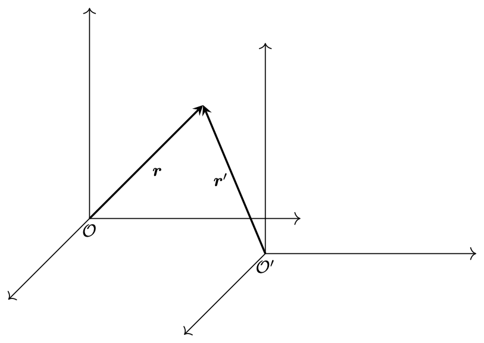



## 뉴턴의 세가지 운동법칙

### 입자, 공간, 시간, 좌표계 {#sec-CM_particle_space_time_reference_frame}

고전역학에서 **입자(particle)** 는 질량을 가지고 있지만 부피가 없는, 혹은 그 부피란 것이 우리가 측정하고자 하는 양에 대해 무시할만한 어떤 추상적인 대상이다. 입자는 3차원 공간상에 존재하며 시간의 변화에 따라 공간상에서 움직일 수 있다. 입자의 시간에 따른 위치를 **경로(path 혹은 trajectory)** 라고 한다. 입자의 경로를 기술하기 위해 공간상에서의 위치의 기준이 되는 원점 $\mathcal{O}$ 을 설정하며, 이 원점에 대한 변위를 **위치 벡터(position vector)** 혹은 **반경 벡터(radius vector)** 라고 한다. 원점은 임의로 정할 수 있다. 고전역학에서 다루는 공간은 3차원 유클리드 공간이며, 원점 $\mathcal{O}$ 에 대해 임의의 표준 기저 $\bf{e}_1,\,\bf{e}_2,\,\bf{e}_3$ (혹은 $\hat{x},\, \hat{y},\, \hat{z}$) 를 관례적으로 $\bf{e}_3 = \bf{e}_1 \times \bf{e}_2$ 가 되도록 잡아 위치벡터 $\bf{r}$ 을 이 표준기저에 대한 좌표로 표현한다. 즉 $\bf{r}(t) = x(t)\bf{e}_1 + y(t) \bf{e}_2 + z(t)\bf{e}_3$ 일 때 $\bf{r}(t)$ 을 $(x(t),\,y(t),\,z(t))$ 혹은 $\begin{bmatrix} x(t) & y(t) & z(t)\end{bmatrix}^T$ 로 표현하며 이를 시간 $t$ 에서의 **좌표(coordinate)** 라고 한다.

{#fig-reference_frames width="70%"}

원점과 표준기저가 정해졌을 모든 위치의 좌표가 정해진다. 이렇게 위치를 특정하기 위해 정해진 원점과 표준기저를 **기준틀(reference frame)** 이라고 한다. 그런데 원점과 표준기저는 임의적이다. 즉 원점 자체는 공간상의 어느 위치에다 정해도 되며, 정해진 원점에 대해서도 가능한 표준기저는 무수히 많다. 즉 좌표계는 개수는 무한대이다. 또한 시간이라는 다른 변수도 존재한다. 하나의 원점 ($\mathcal{O}_1$)에 대해 다른 좌표계의 원점($\mathcal{O}_2$)은 시간에 따라 그 위치가 바뀔 수도 있다. 

어떤 좌표계를 사용하더라도 유지되어야 할 기본적인 양(quantity)이 있다. 하나는 거리이다. 즉 공간상의 두 점 $P_1,\, P_2$ 사이의 거리는 어떤 좌표계에서도 동일해야 한다. 다른 하나는 시간이다. 두 사건의 시간상의 차이 $t_2-t_1$ 은 어느 좌표계에서든 같야야 한다. 아인슈타인 이전에는 이것을 당연하게 생각했으므로 이전에는 여기에 특별한 이름이 붙지 않았다. 이것은 뒤에 나올 상대성 이론과의 가장 큰 차이점이다.

### 뉴턴의 제 1 운동법칙 {#sec-CM_1st_law_of_newton}

#### **뉴턴의 제 1 운동법칙**

속도 $\bf{v}$ 와 가속도 $\bf{a}$ 는 정해진 원점에 대한 위치벡터 $\bf{r}$ 에 대해 아래와 같이 정의된다.

$$
\bf{v} := \dfrac{d\bf{r}}{dt},\qquad \bf{a} :=\dfrac{d\bf{v}}{dt} = \dfrac{d^2 \bf{r}}{dt^2}.
$$ {#eq-CM_definition_of_velocity_and_acceleration}

뉴턴의 제 1 운동법칙은 좌표계 중에 기준이 되는 좌표계를 정하도록 한다. 

::: {.callout-important icon="false"}
#### 뉴턴의 제 1 운동법칙

*Every body continues in its state of rest, or of uniform motion in a straight line, unless it is compelled to change that state by forces impressed upon it.*

외부의 힘이 없다면, 모든 물체는 정지 상태나 직선으로 균일한 운동 상태를 유지한다.

:::

우주에 입자(particle) 하나만 존재하며 당신은 이 입자에 영항을 끼치지 않으면서 위치와 속도를 잴 수 있는 존재라고 하자. 이 입자의 운동에 어떤 영향도 끼치는 존재가 없을 때 그 입자는 정지상태나 직선으로 균일한 운동상태, 즉 등속운동상태를 유지하는 좌표계가 존재한다는 말이며, 이것을 **관성기준틀(inertial frame)** 이라고 한다. 즉 뉴턴의 제 1 법칙은 관성기준틀의 존재를 선언하는 명제라고 볼 수 있다.

#### **갈릴레이 변환**

어떤 관성기준틀 $\mathcal{O}$ 의 위치가 $\bf{r}=(x,\,y,\,z)$ 로 기술되며 다른 기준틀 $\mathcal{O}'$ 의 위치가 $\bf{r}'=(x',\,y',\,z')$ 으로 기술된다고 하자. 이 두 기준틀 사이에 가능한 네가지 변환을 생각하자.

&emsp;($1$) 위치 병진 : $\bf{r}'= \bf{r} + \bf{a}$, 

&emsp;($2$) 회전 : $3\times 3$ 직교행렬 $\bf{R}$ 에 대해 $\bf{r}' = \bf{Rr}$,

&emsp;($3$) Boost : $\bf{r}'= \bf{r}+ \bf{V}t$, for constant $\bf{V}\in \R^3$.

&emsp;($4$) 시간 병진 : $t' = t + s$

이 네가지 경우에 있어 $\mathcal{O}$ 에서의 등속운동은 $\mathcal{O}'$ 에서의 등속운동이며 따라서 $\mathcal{O}$ 가 관성기준틀이라면 $\mathcal{O}'$ 역시 관성기준틀이다. 이렇게 한 관성기준틀을 다른 관성기준틀로 변환시키는 것을 **갈릴레이 변환(Galilean transformation)**, 혹은 **갈릴레이 사상 (Galilean map)** 이라고 하며 갈릴레이 사상의 집합을 **갈릴레이 군 (Galilean group)** 이라고 한다.

각각의 세가지 변환이 갈릴레이 변환이라는 것으로부터 우리는 다음을 알 수 있다.

&emsp;($1$) 모든 위치는 동등하다.

&emsp;($2$) 모든 방향은 동등하다.

&emsp;($3$) 모든 속도는 동등하다.

&emsp;($3$) 모든 시간은 균일하다. 즉 $\Delta t' = \Delta t$.

고전역학에서는 네가지 모두 성립하지만 실제로 우리는 모든 속도가 동등하지 않다는 것을 알고 있다. 빛의 속도 $c$ 는 특별하며 이것은 상대성 이론에서 밝혀지며, 고전역학에서는 그렇지 않다.

### 뉴턴의 제2 운동법칙과 운동량 {#sec-CM_the_1st_law_of_newton}

#### **운동량과 뉴턴의 제 2 운동법칙** 
::: {.callout-important icon="false"}
#### 뉴턴의 제 2 운동법칙

*The change of motion of an object is proportional to the force impressed; and is made in the direction of the straight line in which the force is impressed.*

운동량의 변화는 가해진 힘에 비례하며, 변화의 방향은 가해지는 힘의 방향이다.

:::

논의를 이어가기 전에 중요한 물리량을 정의하자.

::: {.callout-note icon="false"}

#### **선형 운동량** 

입자 $m$ 이 속도 $\bf{v}$ 로 운동할 때 이 입자의 **선형 운동량 (linear momentum)** 혹은 **운동량(momentum)** $\bf{p}$ 는 다음과 같이 정의된다.

$$
\bf{p} := m\bf{v}. 
$$ {#eq-CM_linear_momentum}

:::

#### **힘**

우리는 앞서 관성기준틀을 정의했다. 만약 입자가 정지를 포함한 등속운동 상태이지 않으면 무언가가 입자에 영향을 준다는 의미이며 그것을 **힘(force)** 라고 하고 정량적으로는 운동량 $\bf{p}$ 의 시간에 대한 변화량으로 정의한다. 영어 표현의 *motion* 은 현재 우리가 운동량이라고 부르는 값이다. 즉 외부에서 힘 $\bf{F}$ 가 가해질 때 뉴턴의 제2 운동법칙은 다음을 말한다. 

$$
\dfrac{d\bf{p}}{dt} = \dfrac{d}{dt}(m\bf{v})= \bf{F}.
$$

#### **관성 질량**

질량 $m$ 이 고정되어 있다고 하자. 그렇다면 $\bf{F} = m\dfrac{d^2\bf{r}}{dt^2} = m\bf{a}$ 이며, 힘에 대해 입자의 가속도는 $m$ 에 반비례하여 정해진다.

$$
\bf{a} = \dfrac{1}{m}\bf{F}.
$$

이때의 $m$ 을 **관성질량(inerital mass)**$^1$ 이라고 한다.[$^1$ 관성질량과 비교되는 값은 중력질량이다. 이것은 만유인력을 다룰 때 설명한다.]{.aside} $\bf{F}=\bf{0}$ 일 경우 운동량 $\bf{p}$ 는 일정하게 유지된다. 이것을 **운동량 보존** 이라고 한다.

#### **갈릴레이 변환과 힘**

두 관성기준틀 $\mathcal{O},\, \mathcal{O}'$ 을 생각하자. 앞서 알아본 세가지 갈릴레이 변환과 시간의 균일성을 통해 $\bf{r} = (x_1,\,x_2,\,x_3)$ 와 $\bf{r}'=(x_1',\,x_2',\,x_3')$ 사이에 아래와 같은 관계가 성립한다는 것을 안다.

$$
x_i' = \sum_j R_{ij}x_j + a_j + V_j t.
$$

이 때 $R_{ij}$ 는 직교행렬 $\bf{R}$ 의 성분이다. $\mathcal{O}$ 에서 $m\ddot{x}_j = F_j$ 가 성립한다고 하자. $F'_i = \sum_j R_{ij}F_j$ 이며, $\ddot{x}'_i = \sum_j R_{ij}x_j$ 이므로

$$
F'_i = \sum_j R_{ij}F_j = \sum_j R_{ij}m\ddot{x}_j = m\ddot{x}'_i
$$

이다. $\bf{F}' = \dot{\bf{p}}'$ 이므로 운동방정식은 걸릴레이 변환에 대해 불변이다. 

#### **이차미분방정식**

일반적으로 우리가 아는 한 근본적인 힘은 $\bf{r}$ 와 $\dot{\bf{r}}$, 그리고 시간 $t$ 의 함수이다. 즉 $\bf{F}= \bf{F}(\bf{r},\,\bf{r}',\,t)$ 이다. 그렇다면 입자의 운동방정식은

$$
\dfrac{d^2\bf{r}}{d t^2} = \dfrac{\bf{F}(\bf{r},\,\bf{r}',\,t)}{m}
$$

으로 2차 미분방정식이다. 우리는 미분방정식의 일반이론으로부터 이차 미분방정식을 풀기 위해서는 위치와 속도에 대한 초기조건이 주어져야 한다는 것을 안다. 

### 뉴턴의 제3 운동법칙 {#sec-CM_the_3rd_law_of_newton}

::: {.callout-important icon="false"}
#### 뉴턴의 제 3 운동법칙

*To every action, there is always opposed an equal reaction; or, the mutual actions of two bodies upon each other are always equal, and directed to contrary parts..*

모든 *action* 에 대해 크기가 같고 방향이 반대인 *reaction* 이 존재한다. 즉 두 물체 사이의 상호 *action* 은 항상 크기가 같고 방향이 반대이다.

:::

여기서의 *action*${}^2$ [$^2$ 고전역학에서 action 은 뒤에 나올 라그랑지안의 시간 적분을 의미하기도 하며, 여기를 제외한 다른 부분에서는 주로 이 의미로 사용하겠다. 별도의 언급 없이 action-reaction 의 의미에서 사용하는 것은 여기 뿐이다.]{.aside} 은 한 물체의 존재로 인해 다른 물체에 가해지는 힘을 말한다. 즉 두 물체 사이 $A$ 와 $B$ 사이에 힘이 작용할 때 $B$ 의 존재로 인해 $A$ 가 받는 힘 $\bf{F}_{BA}$ 와 $A$ 의 존재로 인해 $B$ 가 받는 힘 $\bf{F}_{AB}$ 사이에는 $\bf{F}_{BA}=-\bf{F}_{AB}$ 의 관계가 성립한다는 의미이다.

 

## 물리량 

### 각운동량과 토크 {#sec-CM_angular_momentum_and_torque}

::: {.callout-note icon="false"}

#### **각운동량**
각운동량 $\bf{L}$ 은 다음과 같이 정의된다.

$$
\boxed{
\bf{L} := \bf{r} \times \bf{p}
}
$$ {#eq-CM_def_angular_momentum}

:::

각운동량의 시간에 대한 변화는 

$$
\dfrac{d\bf{L}}{dt} = \dfrac{d}{dt} (\bf{r} \times m\bf{v}) = \bf{v} \times m \bf{v} + \bf{r} \times \dfrac{d}{dt}(m\bf{v}) = \bf{r} \times \bf{F}
$$ 

이다. 

::: {.callout-note icon="false"}

#### **토크**

원점 $\mathcal{O}$ 로부터의 **토크(torque)** (혹은 moment of force) $\bf{N}$ 은 다음과 같이 정의된다.

$$
\boxed{
\bf{N} := \bf{r} \times \bf{F}.
}
$$ {#eq-CM_def_torque}

:::

즉 $\bf{N}=0$ 이면 $\bf{L}$ 이 시간에 대해보존됨을 알 수 있다.

### 힘에 의한 일(Work)

::: {.callout-note icon="false"}

#### **일 (work)**
외력 $\bf{F}$ 에 의해 입자가 $P_1$ 지점에서 $P_2$ 지점으로 움직였다고 하자. 이 때, 이 입자에 가해진 힘 $\bf{F}$가 한 일 $W_{12}$는 다음과 같이 정의된다.

$$
\boxed{
W_{12} := \int_{P_1}^{P_2}\bf{F \cdot} d\bf{s}\;.
}
$${#eq-CM_def_work}
:::

$v_1,\, v_2$ 를 각각 $P_1,\,P_2$ 에서의 속도 $\bf{v}_1,\, \bf{v}_2$ 의 크기 라고 하자. 즉 $v_1=\|\bf{v}_1\|,\, v_2=\|\bf{v}_2\|$ 이다. 그렇다면 다음이 성립한다.

$$
W_{12} = \int_{P_1}^{P_2} \bf{F \cdot} d\bf{s} = m \int \dfrac{d\bf{v}}{dt} \cdot \bf{v}\, dt = \dfrac{m}{2} \int \dfrac{dv^2}{dt} dt = \dfrac{1}{2} m ({v_2}^2 - {v_1}^2)\;.
$$

::: {.callout-note icon="false"}

#### **운동 에너지**

질량 $m$ 인 입자가 속력 $v$ 로 움직일 때, 이 입자의 운동에너지 $T$ 는 다음과 같이 정의된다.

$$
\boxed{
T = \dfrac{1}{2}mv^2.
}
$${#eq-CM_def_kinetic_energy}
:::

일과 운동에너지의 정의로부터 $W_{12} = T_2 - T_1$ 이다.

 

### 보존력과 포텐셜 에너지 {#sec-CM_conservative_force_and_potential_energy}

::: {.callout-note icon="false"}

#### **보존력**
외력이 벡터장 $\bf{F}$ 로 주어졌고, 이 $\bf{F}$ 에 의한 일 $W_{12}$ 이 그 경로에 의존하지 않을 때 이 힘 $\bf{F}$ 를 **보존력(conservative force)** 라고 한다. 이 경우 다음을 만족한다.

$$
\oint_C \bf{F \cdot}\, d\bf{s}=0
$$ {#eq-CM_sufficient_condition_for_conservative_force}

:::

수학적으로 이것은 어떤 스칼라장 $V(\bf{r})$ 이 존재하여 $\bf{F}= - \dfrac{\partial V(\bf{r})}{\partial \bf{r}}$ 인 것과 동치이다. 

::: {.callout-note icon="false"}

#### **포텐셜 에너지**

힘 $\bf{F}$ 가 어떤 스칼라장에 대해 $\bf{F}= - \dfrac{\partial V(\bf{r})}{\partial \bf{r}}$ 일 때 $V(\bf{r})$ 을 **포텐셜(potential)** 혹은 **포텐셜 에너지(potential energy)** 라고 한다.

:::

### 입자에 대한 에너지 보존 정리 {#sec-CM_energy_consrvertion}

시스템에 작용하는 모든 힘이 보존력일 때 이 시스템을 **보존계(conservative system)** 라 한다. 보존계에서는 

$$
W_{12} = \int_{P_1}^{P_2} \bf{F \cdot} d \bf{s} = \int_{P_1}^{P_2} -\dfrac{\partial V(\bf{r})}{\partial \bf{r}} \bf{\cdot} d\bf{s} = V(P_1) - V(P_2)
$$ {#eq-CM_energy_conservation_theorem_for_conservative_system}

이다. $V_1=V(P_1)$, $V_2=V(P_2)$ 라 할 경우 $W_{12}=T_2 - T_1 = V_1 - V_2$ 이므로 $T_1 + V_1 = T_2 + V_2$ 이다. 즉 보존계에서는 운동에너지와 위치에너지의 합이 항상 보존된다. 이를 **보존계에서의 에너지 보존**  이라 한다.

포텐셜 $V=V(\bf{x},\,t)$ 가 위치 뿐만 아니라 명시적으로 시간에 의존한다고 하자. 즉 $\partial V/\partial t \ne 0$ 이라고 하자. 이 경우 입자가 $t$ 에서 $t+dt$ 시간 동안 $\bf{x}$ 에서 $\bf{x}+d\bf{s}$ 만큼 움직였을 때의 일은 

$$
\bf{F\cdot}d\bf{s} = - \dfrac{\partial V}{\partial s}ds
$$

이며 이 값은 $-V(\bf{x}+d\bf{s},\, t+dt) + V(\bf{x},\,t)$ 와 같지 않다. 이 경우 역학적 에너지 $T+V$ 는 정의되지만 보존되지는 않는다.

## 입자계의 동역학

###  입자계의 운동방정식 {#sec-CM_equation_of_motion_for_N_particle_system}

다수의 입자로 이루어진 입자계에서 우리는 계를 이루는 입자들 사이의 힘과 입자계 외부의 원인에 의해 입자계의 입자에 가해지는 힘을 모두 고려해야 한다. $N$ 개의 입자로 이루어진 계를 $N$-입자계라고 하자. 입자계에서 $b$-번째 입자가 $a$-번째 입자에 가하는 힘을 $\bf{F}_{ba}$ 라 하고 시스템 외부에서 $a$-번째 입자에 가하는 힘을 $\bf{F}^{(e)}_{a}$ 라 하면 $a$ 번째 입자에 가해지는 힘은 $\sum_b\bf{F}_{ba} + \bf{F}^{(e)}_a$ 이며, 따라서 운동방정식은 다음과 같다.

$$
\dfrac{d\bf{p}_a}{dt} = \frac{d}{dt} (m_a\bf{v}_a) = \sum_b \bf{F}_{ba} + \bf{F}^{(e)}_a.
$$ {#eq-CM_equation_of_motion_in_particle_system}

제 3 운동법칙에 따라 모든 $a,\,b$ 에 대해 $\bf{F}_{ab} = - \bf{F}_{ba}$ 일 경우 모든 입자에 대해 더하면 다음과 같다. 여기서 $\bf{F}^{(e)} = \sum_a \bf{F}^{(e)}_a$ 는 외력(external force) 의 총합이다. 

$$
\dfrac{d^2}{dt^2} \sum_a m_a \bf{r}_a = \sum_i \bf{F}^{(e)}_a + \sum_{\substack{ a ,b \\ a \ne b }} \bf{F}_{ba} = \bf{F}^{(e)}  + 0
$$ {#eq-CM_system_of_particles}

 

### 질량 중심과 입자계의 총 운동량 {#sec-CM_total_momentum_and_COM}  

::: {.callout-note icon="false"}

#### **질량중심**

입자계 에서 **질량 중심(center of mass)** (혹은 center of gravity) $\bf{R}_\text{CM}$ 는 다음과 같이 정의된다.

$$
\bf{R}_\text{CM} = \dfrac{\sum_a m_a \bf{r}_a } {\sum_a m_a} = \dfrac{\sum_a m_a \bf{r}_a}{M}\;.
$$ {#eq-CM_center_of_mass}

여기서 $M=\sum_a m_a$ 는 시스템의 입자의 질량의 총 합이다.

:::

@eq-CM_system_of_particles 으로 부터 다음을 얻는다.

$$
M\dfrac{d^2\bf{R}_\text{CM}}{dt^2} =\bf{F}^{(e)}\;.
$$ {#eq-CM_equation_of_motion_for_center_of_mass_1}

이로부터 **입자계의 작용하는 모든 외력의 합이 질량 중심에 집중하여 작용하는 것처럼 움직인다**는 것을 알 수 있다. 또한 총 운동량 $\bf{p}_\text{tot} = \sum_a \bf{p}_a$ 로부터

$$
\bf{p}_\text{tot}:=\sum_a m_a \dfrac{d\bf{r}_a}{dt} = M \dfrac{d\bf{R}_\text{CM}}{dt}
$$ {#eq-CM_definition_of_total_momentum}

이며, 질량 중심에 대한 운동방정식을 다음과 같이 얻는다. 

$$
\dfrac{d \bf{p}_\text{tot}}{dt} =\bf{F}^{(e)}.
$${#eq-CM_equation_of_motion_for_center_of_mass_2}

즉 외력이 작용하지 않을 때는 입자계의 총 운동량은 보존된다.

### 총 각운동량 {#sec-CM_total_angular_momentum}

$N$-입자계의 총 각운동량 $\bf{L}$ 은 개별 입자의 각운동량의 합으로 정의된다. 즉

$$
\bf{L} :=\sum_{i=a}^N \bf{L}_a
$$ {#eq-CM_total_angular_momentum}

이다. 따라서 

$$
\begin{aligned}
\dfrac{d\bf{L}}{dt} &= \sum_a \dfrac{d}{dt}( \bf{r}_a \times \bf{p}_a) \\
&= \sum_a \dot{\bf{r}}_a \times \bf{p}_a + \bf{r}_a \times \dot{\bf{p}}_a = \sum_i \bf{r}_a \times \bf{F}^{(e)}_a +  \sum_{\substack{ a ,b \\ a \ne b }} \bf{r}_a \times \bf{F}_{ba} 
\end{aligned}
$$ {#eq-CM_derivative_of_total_angular_momentum}

이다. 여기서 $\dot{\bf{r}}_a \times \bf{p}_a = 0$ 이 이용되었다. 뉴턴의 제 3 운동법칙을 따르는 힘 이라면, 즉 $\bf{F}_{ab}= -\bf{F}_{ba}$ 라면, $\bf{r}_{ab} = \bf{r}_a - \bf{r}_b$ 에 대해

$$
\bf{r}_a \times \bf{F}_{ba} + \bf{r}_b \times \bf{F}_{ab} = (\bf{r}_a - \bf{r}_b) \times \bf{F}_{ba} = \bf{r}_{ab} \times \bf{F}_{ba}
$$

로 쓸 수 있다.  

여기서 작용 반작용의 강한 조건, 즉 $\bf{F}_{ba}=F_{ba}\hat{\bf{r}}_{ab}$ 일 경우를 생각하자. 이 경우 @eq-CM_derivative_of_total_angular_momentum 의 마지막 항은 아래와 같이 $0$ 이 된다.

$$
\sum_{\substack{ a ,b \\ a \ne b }} \bf{r}_a \times \bf{F}_{ba} = \sum_{a<b} \bf{r}_{ab}\times \bf{F}_{ba} = 0\;.
$$

그리고 외력 $\bf{F}^{(e)}$에 의한 토크를 $\displaystyle \bf{N}^{(e)}=\sum_a \bf{r}_a \times \bf{F}_a^{(e)}$ 로 정의하면 다음이 성립한다.

$$
\dot{\bf{L}} = \dfrac{d\bf{L}}{dt} = \bf{N}^{(e)}\;.
$$ {#eq-CM_equation_of_motion_for_total_angular_momentum}

::: {.callout-important icon="false"}
#### **작용 반작용의 강한 조건과 약한 조건**

총 운동량 보존은 $\bf{F}_{ab} = -\bf{F}_{ba}$ 만을 가정하였다. 이를 작용-반작용의 약한 조건(Weak form of the action and reaction principle) 라고 한다. 그러나 총 각운동량 보존은 $\bf{F}_{ab} = F_{ab}\hat{\bf{r}}_{ab}$, 즉 중심력(central force) 임을 가정하였다 이를 작용-반작용의 강한 조건 이라고 한다.  

:::

### 질량중심 좌표계 {#sec-CM_COM_refrence_frame}

$N$-입자계의 질량중심 $\bf{R}_\text{CM}=\sum\limits_{i=a}^N m_a \bf{r}_a$ 을 생각하자. $\bf{r}'_a=\bf{r}_a - \bf{R}_\text{CM}$ 이라고 하면 $\bf{r}'_a$ 는 질량 중심 $\bf{R}_\text{CM}$ 을 원점으로 삼은 반경벡터이다. 이 때 질량 중심의 속도 $\bf{V} = \dot{\bf{R}}_\text{CM}$ 에 대해 $\bf{v}'_a = \bf{v}_a -\bf{V}_\text{CM}$ 로 할 수 있다. 그렇다면 총 각운동량은 다음과 같다.

$$
\begin{aligned}
\bf{L} &= \sum_a \bf{r}_i \times m_a \bf{v}_a  \\
&=\sum_a \bf{R}_\text{CM} \times m_a \bf{V}_\text{CM} + \sum_a \bf{r}'_a  \times m_i \bf{v}'_a  \\[0.3em]
& \qquad + \left(\sum_a m_a \bf{r}'_a \right) \times \bf{V}_\text{CM} + \bf{R}_\text{CM} \times \left( \dfrac{d}{dt} \sum_a m_a \bf{r}'_a\right) \\[0.3em]
& = \underbrace{\bf{R}_\text{CM} \times M\bf{V}_\text{CM}}_{\normalsize :=\bf{L}_\text{CM}} + \underbrace{\sum_a \bf{r}'_a \times \bf{p}'_a}_{\normalsize := \bf{L}_R}.
\end{aligned}
$$ {#eq-CM_total_angular_momentum_for_center_of_mass_coord}

즉 원점 $\mathcal{O}$ 에서의 입자계의 총 각운동량 $\bf{L}$ 은 ($1$) 모든 질량이 질량 중심 에 집중되어 있다고 가정할 때의 각운동량 $\bf{L}_\text{CM} := \bf{R}_\text{CM}\times (M\bf{V}_\text{CM})$ 와 ($2$) 질량중심을 새로운 원점으로 했을때의 각운동량 $\bf{L}_R=\sum_a \bf{r}_a' \times \bf{p}'_i$ 의 합이다. 

$N$-입자계의 경우 각 입자마다 3개의 좌표로 표현되며 따라서 이 입자계는 $3N$ 차원 벡터공간에서의 위치로 표현된다. 이 $3N$ 차원 벡터공간상의 위치 $P_1$ 에서 $P_2$ 로 이동했을 때의 총 일 $W_{12}$ 는 다음과 같다.
$$ 
W_{12} = \sum_i \int_{P_1}^{P_2} \bf{F}_i \cdot d\bf{s}_i = \sum_i  \int_{P_1}^{P_2} \bf{F}_i^{(e)}\cdot d\bf{s}_i + \sum_{\substack{i,j \\ i \ne j }}  \int_{P_1}^{P_2}\bf{F}_{ji}\cdot d\bf{s}_i\;.
$$ {#eq-work_system_of_particles}

단일 입자의 경우를 생각하면,

$$
\begin{aligned}
\sum_i \int_{P_1}^{P_2} \bf{F}_i \cdot d\bf{s}_i &= \sum_i \int_{P_1}^{P_2} m_i \bf{v}_i \cdot \bf{v}_i dt = \sum_i \int_{P_1}^{P_2} d\left(\dfrac{1}{2} m_i v_i^2\right) \\[0.3em]
&= \underbrace{\sum_i \dfrac{1}{2}m(v_i (P_2))^2}_{\normalsize =T_1} - \underbrace{\sum_i \dfrac{1}{2} m_i (v_i (P_1))^2}_{\normalsize = T2} = T_2-T_2. 
\end{aligned}
$$

여기서 총 운동에너지를 $T := \dfrac{1}{2} \sum\limits_i m_i v_i^2$ 로 하였다.

질량중심 좌표계에서의 총 운동에너지는 다음과 같이 표현 할 수 있다.

$$
T=\frac{1}{2} \sum_i m_i (\bf{V}_\text{CM} + \bf{v}'_i) \cdot (\bf{V}_\text{CM} + \bf{v}'_i)  = \dfrac{1}{2} MV_\text{CM}^2 + \dfrac{1}{2} \sum_i m_i {{v'}_i}^2.
$$ {#eq-CM_total_kinetic_energy_in_center_of_mass_coord}

즉 입자계의 총 운동에너지 $T$ 는 모든 질량이 질량중심 에 집중되어 있다고 가정할 때의 운동에너지와 질량 중심을 원점으로 했을때의 각 입자의 운동에너지의 총합의 합이다. 

각각의 외력 $\bf{F}_i^{(e)}$ 가 어떤 스칼라 함수 $-V_i$ 의 미분일 경우를 생각하자. 즉 $\bf{F}_i^{(e)} = - \dfrac{\partial V_i}{\partial \bf{r}}$ 일 경우,

$$
\sum_i \int_{P_1}^{P_2} \bf{F}_i^{(e)} \cdot d\bf{s}_i = - \sum_i \int_{P_1}^{P_2} \left(\dfrac{\partial V_i}{\partial \bf{r}_i}\right) \cdot d\bf{s}_i = - \left. \sum_i V_i\right|_{P_1}^{P_2} = \sum_a V_i (P_1) - V_a(P_2)
$$

이다. 입자 상호간의 힘 역시 보존력이라면, $\bf{F}_{ji}$ 와 $\bf{F}_{ij}$ 가 포텐셜 $V_{ij}$ 로 부터 얻어 질 수 있다. 강한 작용-반작용 조건에서 $V_{ij} = V(|\bf{r}_i -\bf{r}_j|)$ 이며 

$$
\bf{F}_{ji} = -\dfrac{\partial V_{ij}}{\partial \bf{r}_i} = + \dfrac{\partial V_{ij}}{\partial \bf{r}_j} = -\bf{F}_{ij}
$$

이므로 $\bf{F}_{ji}$ 와 $\bf{F}_{ij}$ 모두 두 입자의 위치를 잇는 선상에 위치한다. 즉 어떤 스칼라 함수 $f$ 에 대해, $V_{ij}$ 는 다음과 같은 형태이다.

$$
\dfrac{\partial V_{ij}(|\bf{r}_i - \bf{r}_j|)}{\partial \bf{r}_j} = (\bf{r}_i - \bf{r}_j) f.
$$

만약 $V_{ij}$ 가 $\bf{r}_i - \bf{r}_j$ 이외의 다른 물리량에 의존한다면, 예를들어 $i$ 번째 입자의 속도 $\bf{v}_i$ 에 대해 $V_{ij} = V(|\bf{v}_i - \bf{v}_j |)$ 이거나 $i$ 번째 입자의 스핀 $\bf{S}_i$ 에 대해 $V(|\bf{S}_i - \bf{S}_j|)$ 꼴이라면 $\bf{F}_{ij} = -\bf{F}_{ji}$ 의 작용 반작용의 약한 조건은 만족하지만 강한 조건은 만족하지 않는다. 

$\bf{r}_{ij} = \bf{r}_i-\bf{r}_j$ 라고 놓자. 그렇다면

$$
\bf{F}_{ji} = - \dfrac{\partial V_{ij}(\bf{r}_{ij})}{\partial \bf{r}_{ij}} = -\dfrac{\partial V_{ij}}{\partial \bf{r}_i} = \dfrac{\partial V_{ij}}{\partial \bf{r}_j} = - \bf{F}_{ij}
$$

이며

$$
d\bf{r}_{ij} = d\bf{r}_i -d\bf{r}_j
$$

이다. 입자간의 힘이 보존력이라면 @eq-work_system_of_particles 의 두번째 항은 위의 두 식을 이용하면

$$
\begin{aligned}
\sum_{\substack{i ,j \\ i \ne j }} \int_{P_1}^{P_2} \bf{F}_{ji}\cdot d\bf{s}_i  &= - \dfrac{1}{2} \sum_{\substack{i ,j \\ i \ne j }} \int_{P_1}^{P_2} \left( \dfrac{\partial V_{ij}}{\partial \bf{r}_i} \bf{\cdot} d\bf{s}_i+  \dfrac{\partial V_{ij}}{\partial \bf{r}_j} \bf{\cdot} d\bf{s}_j\right)  \\
&= -\dfrac{1}{2}\sum_{\substack{ i ,j \\ i \ne j }} \int_{P_1}^{P_2}  \dfrac{\partial V_{ij}}{\partial \bf{r}_{ij}} \bf{\cdot} d\bf{r}_{ab} = -\dfrac{1}{2} \left. \sum_{\substack{i ,j \\ i \ne j }}  V_{ij}\right|_{P_1}^{P_2}
\end{aligned}
$$

이다.

::: {.callout-caution appearance="minimal" icon="false"}
만약 시스템의 내부 힘과 외력 모두 scalar function (즉 potential function)의 미분으로 표현 될 수 있다면 우리는 시스템의 **total potential energy** $V$를 다음과 같이 정의 할 수 있다.
$$
V=\sum_i V_i + \dfrac{1}{2} \sum_{\substack{i,j \\ i \ne j }} V_{ij}\;.
$$
::: 

 

## 구속조건과 일반화된 좌표계

### 구속조건 {#sec-CM_constraints}
**구속조건(Constraint)** 는 운동방정식의 제한조건을 의미한다. 예를 들어 강체의 경우 $|\bf{r}_a - \bf{r}_b| =c_{ab} = \text{const.}$

구속조건이 시간과 위치에 대한 함수이며 다음과 같은 꼴로 표현 될 수 있을 때 **holonomic** 이라 한다. 

$$
f(\bf{r}_1,\,\bf{r}_2,\ldots,\,t) =0.
$$ {#eq-CM_holonomic_constraint}

Holonomic 하지 않은 구속조건은 **nonholonomic** 이라고 한다.

구속조건에 명시적인 시간 의존성이 없을 때, 즉 $\dfrac{\partial}{\partial t} f(\bf{r}_i;\, \dot{\bf{r}}_i ;\,t)=0$  일 때 **scleronomous constraint** 라 하며 아닐 때 **rheonomous constraint** 라 한다. 

 

### 일반화된 좌표계와 짜임새 공간 {#sec-CM_generalized_coordinates}

#### **짜임새 공간**

물체의 운동을 기술할 때 구속조건이 부여된다면 두가지 어려운 점이 발생한다. 우선 좌표 $(r_1,\,r_2,\ldots)$ 는 더이상 서로 독립적이지 하지 않다. 두번째로는 **구속력(force of constraint)** 문제가 있다. 이중 첫번째에 대해 구속조건이 holonomic 할 때 소위 **일반화된 좌표계(generalized coordinate)** 를 사용함으로서 문제를 풀 수 있다. 

$N$-입자계를 생각하자. 구속조건이 없다면 $3N$ 개의 독립적인 좌표변수가 존재한다. 이렇게 시스템을 기술하는데 필요한 독립적인 변수의 갯수를 **자유도(degree of freedom)** 라고 한다. 만약 $k$ 개의 독립적인 holonomic 구속조건이 존재한다면 이 입자계의 자유도는 $3N-k$ 가 될 것이다. 그렇다면 이 입자계는 $3N-k$ 개의 독립변수 $q_1,\ldots,\,q_{3N-k}$ 로 기술 될 수 있다. 즉 $\bf{r}_a = \bf{r}_a (q_1,\ldots,\,q_{3N-k},t)$ for $i=1,\ldots,\,3N-k$. 이 경우 $q_i$ 가 거리 단위의 값일 필요가 없으며 어떤 $(q_i,\,q_j,\,q_k)$ 가 벡터일 필요도 없다. *모든 종류의 물리량이 일반화된 좌표계의 좌표변수가 될 수 있다.* Nonhonolomic 구속조건의 경우는 독립변수의 개수를 줄이는 데 사용 될 수 없다. 이 일반화된 좌표에 대해 짜임새 공간이 아래와 같이 정의된다.

::: {.callout-note icon="false"}

#### **짜임새 공간**

어떤 $n$-자유도 시스템의 **짜임새 공간 (configuration space)** 은 이 시스템의 $n$ 개의 일반화된 좌표가 가질 수 있는 값의 집합이다.

:::

짜임새 공간에서는 거리적 특성보다 위상적 특성(topological property) 가 보존된다. 예를 들어 자유 입자에 대한 데카르트 좌표계 $x,\,y,\,z$ 짜임새 공간을 $C_D$, 구면좌표계 $r,\,\theta,\,\varphi$ 에서의 짜임새 공간을 $C_S$ 라고 하자. $C_D$ 에서의 직선은 $C_S$ 에서의 직선이 아니며, 거리, 각도, 면적과 같은 거리적 틍성 역시 그러하다. 그러나 $C_D$ 에서의 점은 $C_S$ 에서의 점이며, 곡선도 역시 곡선이고, 근방 역시 근방이다. 따라서 해석 역학은 미분기하학적 성질이 매우 중요해진다.

자유도 $n$ 인 계의 두 일반화된 좌표계 $\bf{q}=(q_1,\ldots,\,q_n)$ 로 기술되는 공간 $S$ 와 $\overline{\bf{q}}=(\overline{q}_1,\ldots,\overline{q}_n)$ 로 기술되는 공간 $\overline{S}$ 사이에 $C^1$ 급 전단사 사상 $F:S \to \overline{S}$ 가 존재하여 
$$
\overline{\bf{q}} = F(\bf{q}),\qquad q_j = F_i (\bf{q}),\quad \text{where }i=1,\ldots,\,n
$$

이어야 한다. 따라서 이 변환에 대한 야코비안 $J_F$ 의 행렬식은 $0$ 이 아니다. 또한

$$
d\overline{q}_j = \sum_i\dfrac{\partial F_j}{\partial q_i}dq_i,\qquad i=1,\ldots,\,n
$$

의 관계가 성립한다. 또한 이로부터 $S$ 에서의 미소 영역에서의 직선은 $\overline{S}$ 에서의 직선이며 $S$ 의 미소영역에서의 평행선은 $\overline{S}$ 에서의 평행선이다. 물론 앞서 말했듯이 각이나 길이는 달라진다. 또한 $S$ 에서의 $P$ 근처의 미소부피 $v_P$ 에 대해 $\overline{S}$ 로 변환된 부피는 $|\det (J_F(P))|\cdot v_P$ 이다. 

### 운동에너지와 리만 기하학$^3$ {#sec-CM_kinetic_energy_and_riemanian_geometry}

[$^3$ @Lanczos2012variational 의 5절을 요약한다.]{.aside}

리만 기하학은 선소(line element) $\overline{ds}$ 에 기반한다. 인접한 두 점 사이의 거리 $\overline{ds}$ 는 좌표와 그 1차 미분형식에 의해 주어진다. 유클리드 공간에서는 피타고라스 정리에 의해

$$
\overline{ds^2} = dx^2 + dy^2 +dz^2 
$$ {#eq-CM_definition_of_line_element}

이다. 지금부터는 @eq-CM_definition_of_line_element 를 선소에 대한 표현으로서 증명 없이 받아들이자$^4$.[$^4$ $\overline{ds}$ 는 어떤 미분형식이 아니라 표현식이다. 즉 $dx$ 는 $x$ 에 대한 $d$ 라면 $\overline{ds}$ 는 그렇지 않다. 만약 $\overline{ds}$ 가 적분가능하다면 두 점 사이의 거리는 어떤 경로에서도 동일하다.]{.aside} 구면좌표계에서는

$$
\overline{ds^2} = dr^2 + r^2d\theta^2 + r^2 \sin^2\theta d\varphi^2.
$${#eq-CM_definition_of_line_element_in_spherical_coordinate}

알반적으로 곡면좌표계에서는

$$
\overline{ds^2} =\sum_{i,j=1}^3g_{ij} dx_i dx_j,
$$

이며 여기서 $g_{ij}$ 는 **메트릭 텐서 (metric tensor)** 라고 불리는 대칭 텐서로서

$$
g_{ij}=g_{ji}
$$

이다. $n$ 차원 공간에서는

$$
\overline{ds^2} = \sum_{i,\,j=1}^n g_{ij}x_ix_j,\qquad g_{ij} = g_{ji}
$$ {#eq-CM_riemannian_square_distance}

이다. 

일반적으로 $g_{ij}$ 는 $x_1,\ldots,\,x_n$ 의 함수이지만 직선좌표계(rectlinear coordinate system) 에서는 상수이다. 이 메트릭 텐서는 공간의 기하학을 이해하는 핵심이다. @eq-CM_riemannian_square_distance 로 주어지는 선소는 유클리드 공준을 뛰어넘는 기하학을 구축하는 기반이다. $g_{ij}$ 가 유클리드 공준에서 벗어난다면 다음의 두가지 특징을 갖는 새로운 형태의 기하학이 등장한다.

1. 공간의 특성은 위치마다 다르지면 연속적으로 변화한다.
2. 광역적으로는 유클리드 기하학이 적용되지 않더라도 국소적으로는 적용된다.

아인슈타인과 민코프스키에 의해 특수상대성 이론을 통해 시간과 공간이 합쳐져 4차원을 구성할 때에도 기하학은 유클리드 타입이었지만 아인슈타인의 일반상대성이론에서는 열개의 독립적인 $g_{ij}$ 성분에 대한 선소가 시간과 공간의 함수이어야 만 했다. 여기서 만유인력이라는 신비로운 힘은 시공간의 리만 구조에서 기인하는 순수하게 기하학적인 힘이 되었다.

리만기하학의 추상화는 상대성 이론 뿐만 아니라 해석역학에서도 사용된다. 리만기하학의 개념과 텐서 해석학$^5$[$^5$ Lanczos 는 절대 미적분학 (absolute calculus) 이라는 구세대 용어로 표현한다.]{.aside} 의 방법론은 해석 역학을 이용해 동역학을 푸는데 매우 유용하다. 

기하학이 역학과 연결되는 부분은 관성질량이다. 뉴튼의 제 2 법칙에서 관성질량은 $\bf{F}=m\bf{a}$ 의 $m$ 으로 나타나며, 해석역학에서는 운동에너지 $\frac{1}{2}mv^2$ 의 $m$ 으로 나타난다. 입자의 속도 $v$ 는

$$
v^2 = \left(\dfrac{\overline{ds}}{dt}\right)^2 = \dfrac{dx^2+dy^2+dz^2}{dt^2}
$$

이므로 운동에너지는 선소 $\overline{ds}$ 와 명시적으로 관련되며, 따라서 공간의 기하학에 의존한다. $3N$ 차원 공간에서의 선소를 다음과 같이 정의하자.
$$
\overline{ds^2} := 2Tdt^2 = \sum_{i=1}^N m_i v_i^2\,dt^2 = \sum_i^N m_i \left(dx_i^2+dy_i^2+dz_i^2\right)
$$ {#eq-CM_definition_of_line_element_for_3n_dimension_space}

그렇다면 역학계의 총 운동에너지는

$$
T = \dfrac{1}{2}m\left(\dfrac{\overline{ds^2}}{dt^2}\right),\qquad \text{with }m=1.
$$ {#eq-CM_kinetic_energy_using_3N_dimensional_line_element}

즉 전체 역학계의 총 운동에너지는 질량 $1$ 인 단일 입자의 운동에너지로 치환 될 수 있으며, 이 가상의 입자는 $3N$-차원 짜입새 공간에서의 점으로 표현된다. @eq-CM_definition_of_line_element_for_3n_dimension_space 는 $N$-개의 자유입자에대한 짜임새 공간은 

$$
\sqrt{m_i}x_i,\, \sqrt{m_i}y_i,\, \sqrt{m_i}z_i
$$ {#eq-CM_lanczos_rectangular_coord_for_free_N_particle_system} 

가 직교좌표계를 이루는 공간으로 생각되어야 한다는 것을 의미한다. 

@eq-CM_lanczos_rectangular_coord_for_free_N_particle_system 직교좌표계가 $x_i = x_i(q_1,\ldots,\,q_{3N})$ 좌표변환에 의해 곡면 좌표계로 바뀌면 선소에 대한 식은 @eq-CM_riemannian_square_distance 같은 리만 형태가 되더라도 기하학 자체는 유클리드이다. 그러나 구속조건이 부여된다면 상황이 달라진다.

::: {.callout-tip icon="false"}

#### 유클리드 기하학

> **Q : **그렇다면 기하가 유클리드라는 말의 정확한 의미는 뭐야?

정확한 정의는 이거야. 선소를 $\overline{ds}^2 = \sum_i dX_i^²$ (즉 $g_{ik} = \delta_{ik}$)로 만드는 좌표 $X$ 가 존재하는 공간을 Euclid 공간이라고 해. **지금 쓰는 좌표에서 그 꼴이냐가 아니라, 그런 좌표가 존재하느냐가 기준이야.**

그런데 이 정의는 "그런 좌표를 찾아봐야 안다"는 문제가 있어서, 좌표를 찾지 않고도 판정할 수 있는 동치 조건이 필요해. 그게 Riemann의 정리야.

> Riemann curvature tensor가 모든 점에서 0이다 $\iff$ 각 점 근방에서 $g_{ik}  = $\delta_{ik}$ 가 되는 좌표가 존재한다.

Curvature tensor는 $g_{ik}$ 와 그 1차, 2차 미분으로 계산되니까, 주어진 좌표에서 기계적으로 계산해서 0인지 보면 돼. 극좌표 $dr^2 + r^2\theta^2$ 로 계산하면 0이 나오고, 구면에서는 $1/R^2$ 이 나와.

같은 내용을 기하적으로 말하는 방법도 여러 개 있고 전부 동치야.

- 벡터를 평행이동시킨 결과가 경로에 의존하지 않는다 (국소적으로).
- Geodesic으로 만든 삼각형의 내각 합이 정확히 $\pi$ 다.
- 반지름 $r$ 인 geodesic 원의 둘레가 정확히 $2\pi r$ 이다.

왜 curvature가 판정 기준인가. 평평한 좌표 $X_a$ 를 찾는다는 건

$$
g_{ik} = \sum_a \frac{\partial X_a}{\partial q_i}\frac{\partial X_a}{\partial q_k}
$$

를 푸는 거야. $n$ 차원에서 미지 함수는 $n$ 개인데 방정식은 $n(n+1)/2$ 개라서 $n \ge 2$ 면 식이 더 많아. 그래서 아무 $g_{ik}$ 에 대해서나 풀리지 않고, 풀리기 위한 적분 가능 조건이 있어야 하는데 그게 Riemann tensor = 0 이야. 2차원이면 식 3개에 함수 2개라 조건이 하나 남고, 그게 Gaussian curvature $K = 0$ 이야.

이건 어제 Poincaré lemma 얘기와 직접 이어져. Curvature가 0이면 평행이동이 경로에 무관하니까, 어디서나 서로 직교하고 평행한 1-form 들 $e^a$ 를 깔 수 있어. 이것들은 평행하니까 $de^a = 0$, 즉 closed야. 그러면 Poincaré lemma로 $e^a = dX^a$ 인 함수 $X^a$ 가 있고, 그게 바로 찾던 평평한 좌표야. “Closed면 exact”의 기하학 버전인 셈이야.

국소와 전역의 구분. 위 정리는 "각 점 근방에서"야. 원통이나 flat torus는 curvature가 0이라 국소적으로 Euclid지만, 전체를 한 장의 직교좌표로 덮을 수는 없어. 이것도 Poincaré lemma가 구멍 있는 영역에서 실패하는 것과 같은 현상이고. 엄밀히 “Euclid 공간이다”라고 하려면 전체에서 통하는 좌표 하나가 있어야 해. Lanczos의 경우는 $\sqrt{m_i}x_i$ 라는 전역 좌표가 처음부터 있으니까 3N차원 공간 전체가 진짜 Euclid 공간이야.

Lanczos가 그 절에서 이 정의를 명시하지 않고 "기하는 Euclid로 남는다"고만 쓰는 건 좀 불친절해. 독자가 Riemann 기하를 이미 안다고 전제하는 건데, 정작 그 책의 대상 독자한테는 설명이 필요한 대목이거든.

크게 보면 "기하"라는 말은 좌표 변환에 대해 불변인 성질들의 모임을 뜻하고, metric이 주어진 공간에서 그 불변 정보는 국소적으로 curvature tensor에 다 들어 있어. 그래서 "기하가 Euclid다"는 "불변량이 전부 자명하다"는 말이고, constraint가 걸려서 curvature가 0이 아니게 되는 순간부터 역학이 진짜 Riemann 기하의 문제가 돼.

:::

구속조건이 

$$
\begin{aligned}
f_1(x_1,\ldots,\,z_N) &=  0, \\[0.3em]
\vdots \\[0.3em]
f_m(x_1,\ldots,\,z_N) &= 0
\end{aligned}
$$ {#eq-CM_constraints_depends_only_on_position}
 
과 같이 주어졌다면 두가지 방법이 있다. 

**1.** 각각의 @eq-CM_constraints_depends_only_on_position 는 $3N$ 차원 공간의 초평면을 의미하며 모든 식에 의해 $3N-m=n$ 차원의 부분공간에서만 짜임새 공간의 점이 위치할 수 있다. 이 부분공간은 더이상 평평항 유클리드 공간이 아닌 휘어진 리만 공간이다.

**2.** 처음부터 직교좌표 $x_1,\ldots,\,z_{N}$ 에 대해 $n=3N-m$ 개의 일반화된 좌표 $q_1,\ldots,\,q_n$ 를 사용한다. 이 일반회된 좌표는 곡면 좌표이며 일반화된 좌표에 대한 선소는 @eq-CM_definition_of_line_element_for_3n_dimension_space 로부터 얻을 수 있다. 즉 선소를 일반화된 좌표를 이용하여 다음의 형태로 얻을 수 있다.

$$
\overline{ds^2} = \sum_{i,\,k=1}^{3N-m} a_{ik}dq_i dq_k .
$$ {#eq-CM_line_element_of_generalized_coordinates}

이 선소는 진정으로 리만적인다 $q_i$ 들이 곡면 좌표일 뿐만 아니라 짜임새 공간의 기하학이 원래의 $3N$ 차원 공간의 유클리드 구조를 유지하지 않기 때문이다. 이로부터 역학 문제는 미분기하학의 문제로 번역된다.

 

## 달랑베르 원리

### 가상 변위와 가상 일의 원리 {#sec-CM_principle_of_virtural_work}

::: {.callout-note icon="false"}

#### **가상 변위와 가상 일**

시스템의 **가상 변위 (virtual displacement)** 는 주어진 시간 $t$ 에서 주어진 힘과 구속조건에서 반경벡터의 가능한 미소 변화 $\delta \bf{r}_a$ 에 의한 짜임새 공간상의 미소 변화를 의미한다. 가상(virtual)이란 이름이 붙은 이유는 물리적으로 실제의 변위는 특정 시간 간격에서 발생하지만 가상 변위는 시간 $t$ 가 고정되어 있기 때문이다.

힘 $\bf{F}$ 가 주어진 계와 주어진 구속조건을 만족하는 가상 변위 $\delta \bf{r}$ 에 대해 아래와 같이 정의된 $\delta W$ 를 **가상 일 (virtural work)** 라고 한다.

$$
\delta W = \bf{F \cdot} \delta \bf{r}.
$$ {#eq-CM_definition_of_virtual_work}

:::

시스템이 평형상태일 경우를 가정하자. 또한 이 시스템에서의 가상 변위 $\delta \bf{r}_i$ 가 가능하다면 $-\delta \bf{r}_i$ 역시 가능하다고 가정한다. 이것을 가역 가상 변위 (reversible virtual displacement) 라고 한다. 

평형상태이므로 $i$ 번째 입자에 작용하는 힘 $\bf{F}_i = 0$ 이며 따라서 $\bf{F}_i \cdot \delta \bf{r}_i=0$ 이다. 또한 $\sum\limits_i \bf{F}_i \cdot \delta \bf{r}_i = 0$ 임은 자명하다. $\bf{F}_i$ 를 작용력(applied force) $\bf{F}^{(a)}_i$ 와 구속력 $\bf{f}_i$ 로 분리 할 수 있다. 즉 $\bf{F}_i = \bf{F}^{(a)}_i + \bf{f}_i$ 이며 따라서 다음이 성립한다.

$$
\sum_i \bf{F}_i \bf{\cdot} \delta \bf{r}_i = \sum_i \bf{F}^{(a)}_i\bf{\cdot} \delta \bf{r}_i + \sum_i\bf{f}_i \bf{\cdot} \delta \bf{r}_i = 0\;.
$$

::: {.callout-important icon="false"}

#### **구속력에 의한 가상 일 공리**

주어진 구속 조건을 만족하는 가역인 가상 변위 $\delta \bf{r}_i$ 에 대해 구속력이 하는 가상 일은 항상 $0$ 이다. 즉,

$$
\sum_i \bf{f}_i \bf\cdot \delta \bf{r}_i = 0.
$$ {#eq-CM_virtual_work_by_constraint_force}

:::

가상 변위 $\delta \bf{r}_i$ 은 constraint 곡면에 접하는 방향이므로 $\bf{f}_i$ 의 방향은 $i$ 번째 입자의 구속조건에 의해 결정되는 평면에 수직이다. 구속 조건이 $g_l = 0$ 형태로 주어지면

$$
\bf{f}_i =  \lambda_i \dfrac{\partial g_i}{\partial \bf{x}}
$$

이다. 즉 라그랑쥬 승수법 그 자체다. 즉 구속력에 의한 가상 일 공리는 "구속력의 방향은 구속조건의 기하가 정하고, 크기 $\lambda$ 만 미지수로 남는다는 주장이다.

이것이 공리여야 하는 이유가 여기 있다. 뉴턴 법칙은 구속력이 뭔지 말해주지 않는다. $\bf{F} = m\bf{a}$ 에 미지의 구속력들을 넣으면 미지수가 식보다 많아서 문제가 안 닫힌다. 구속력에 대한 추가 가정이 있어야 하고, 그게 구속력에 의한 가상 일 공리이다. 매끄러운 면이나 강체같은 표준적인 경우는 개별적으로 확인할 수 있지만(rigid body는 내력이 입자를 잇는 선 방향이라는 가정이 필요하다), 일반적으로는 뉴턴 법칙에서 유도되지 않는 독립된 가정이다$^6$. [$^6$ Goldstein 1장은 이 점을 분명히 안 해서, 달랑베르 원리가 뉴턴 법칙의 단순한 재서술처럼 읽힐 수도 있다.]{.aside} 그리고 이제 이로부터 다음의 자연스러운 결론이 나온다.

::: {.callout-important icon="false"}

#### **가상 일의 원리**

시스템이 평형상태일 때, 작용력에 의한 가상 일 $\delta W$ 은 $0$ 이다. 즉
$$
\delta W = \sum_i \bf{F}^{(a)}_i \cdot \delta \bf{r}_i = 0.
$$ {#eq-CM_principle_of_virtual_work}

:::

여기서 구속 조건이 있을 때 $\delta \bf{r}_i$ 들은 서로 독립이 아니며 따라서 그 계수인 $\bf{F}^{(a)}_i$ 도 모두 $0$ 이 아니어도 된다. 즉 일반적으로 $\bf{F}^{(a)}_i \ne \bf{0}$ 이다.  

이렇게 되면 각각의 $i$ 번째 입자에 대해 $\bf{F}^{(a)}_i$ 가 $0$ 인 조건이 아니게 되며, 따라서 $\delta \bf{r}_i$ 는 서로 독립적이지 않게 되고 위의 @eq-CM_principle_of_virtual_work 가 하나의 구속조건이며 따라서 일반화된 좌표계에 대한 가상 변위로 변환해야 한다. @eq-CM_principle_of_virtual_work 는 구속력 $\bf{f}_a$ 를 포함하지 않는다는 측면에서 우리가 원하는 것이지만 단지 정적인 경우만을 다룬다는 점에서 부족하다. 우리는 이것으로 부터 우리가 원하는 운동방정식을 얻고자 한다.

### 달랑베르 원리 {#sec-CM_dlambert_principle}

운동방정식 $\bf{F}_j = \dot{\bf{p}}_j$ 로부터 시작하자. $\bf{F}_j - \dot{\bf{p}}_j=\bf{0}$ 이며 이것은 시스템의 입자들이 실제 힘 $\bf{F}_j$ 와 소위 *역 유효힘(reversed effecvive force*) 인 $-\dot{\bf{p}}_j$ 의 합에 의해 평행상태에 있게 된다는 의미이다. 여기에 가상 변위를 적용하면

$$
\sum_j \left( \bf{F}_j - \dot{\bf{p}}_j \right) \bf{\cdot} \delta \bf{r}_j = 0
$$

라고 쓸 수 있다. $\bf{F}_j = \bf{F}^{(a)}_j + \bf{f}_j$ 로 놓으면

$$
\sum_j \left(\bf{F}^{(a)}_j - \dot{\bf{p}}_j\right) \bf{\cdot}\delta \bf{r}_j + \sum_j \bf{f}_j \bf{\cdot}\delta \bf{r}_j = 0
$$

이며 구속력에 의한 가상 일이 $0$ 이라는 조건을 입히면,

$$
\sum_j \left( \bf{F}^{(a)}_j - \dot{\bf{p}}_j \right) \bf{\cdot} \delta \bf{r}_j = 0\;
$$ {#eq-CM_dalembert_principle}

이다. 이것을 **달랑베르 원리(D'Alembert's principle)** 라고 한다. 위 식에는 구속력이 포함되지 않으므로 위첨자 $(a)$ 를 떼어도 모호하지 않을 것이다. 여기서 우리는 항상 일반적인 데카르트 좌표계가 아닌 일반화된 좌표계에서 기술해야 하며 @eq-CM_dalembert_principle 도 일반화된 좌표계로 변환하여야 한다는 것이다. 앞에서도 그랬지만 자유도가 $n$ 인 일반화된 좌표계의 좌표를 $(q_1,\ldots,\,q_n)$ 으로 표기하기로 한다.

### 일반화된 좌표계에서의 달랑베르 원리 {#sec-CM_dlambert_principle_in_generalized_coordinate}

일반화된 좌표계 $(q_1,\,q_2,\ldots,\,q_n)$ 을 생각하자. $\bf{r}_a = \bf{r}_a (q_1,\ldots,\,q_n,\,t)$ 이므로 미분의 연쇄 규칙에 의해

$$
\bf{v}_a = \dfrac{d\bf{r}_a}{dt} = \sum_k \dfrac{\partial \bf{r}_a}{\partial q_k} \dot{q}_k + \dfrac{\partial \bf{r}_a}{\partial t} 
$$ {#eq-CM_dlambert_0}

이다. 우리는 이로부터

$$
\boxed{\dfrac{\partial \bf{v}_a}{\partial \dot{q}_k} = \dfrac{\partial \bf{r}_a}{\partial q_k}}
$$ {#eq-CM_dlambert_1}

임을 알 수 있다. 가상 변위 $\delta \bf{r}_a$ 는 정의에 의해 공간 변수만 생각하므로 시간 $t$ 에 대한 편미분 항이 없다. 따라서

$$
\boxed{\delta \bf{r}_a = \sum_j\dfrac{\partial \bf{r}_a}{\partial q_j} \delta q_j.}
$$ {#eq-CM_virtual_displacement_and_generalized_coordinate}

이제, 

$$
\sum_a \bf{F}_a \cdot \delta \bf{r}_a = \sum_{a,\,j} \bf{F}_a \cdot \left( \dfrac{\partial \bf{r}_a}{\partial q_j}\right) \delta q_j = \sum_j Q_j \delta q_j
$$ {#eq-CM_generalized_force_0}

를 통해 **일반화된 힘(generalized force)** $Q_j$ 를 아래와 같이 정의한다. 

$$
\boxed{
Q_j = \sum\limits_a \bf{F}_a \cdot \dfrac{\partial \bf{r}_a}{\partial q_j}
}
$$ {#eq-CM_generalized_force}

일반화된 좌표계에서 $q_j$ 가 거리의 차원을 갖지 않아도 되기 때문에 $Q_j$ 역시 힘과 같은 차원을 가질 필요는 없다. 다만 $Q_j \delta q_j$ 는 일(Work)과 같은 차원을 갖는다.

### 라그랑쥬 방정식 {#sec-CM_lagrange_equation}

#### **일반화된 힘에 대한 라그랑쥬 방정식**

달랑베르 원리(@eq-CM_dalembert_principle) 는 $\sum\limits_a \dot{\bf{p}}_a \bf{\cdot} \delta \bf{r}_a = \sum\limits_a m_a \ddot{\bf{r}}_a \bf{\cdot} \delta \bf{r}_a$ 로 쓸 수 있으며 

$$
\sum\limits_a m_a \ddot{\bf{r}}_a \bf{\cdot} \delta \bf{r}_a = \sum\limits_{a,\,j} m_a \ddot{\bf{r}}_a \cdot \dfrac{\partial \bf{r}_a}{\partial q_j} \delta q_j
$$ {#eq-CM_sec_lagrange_1}

이다. 또한 @eq-CM_dlambert_0 를 이용하면

$$
\begin{aligned}
\dfrac{d}{dt} \left(\dfrac{\partial \bf{r}_a}{\partial q_j} \right) &= \sum_k \dfrac{ \partial^2 \bf{r}_a }{\partial q_j \partial q_k} \dot{q}_k + \dfrac{\partial^2 \bf{r}_a}{\partial q_j \partial t}  \\[0.3em]
&=\dfrac{\partial}{\partial q_j}\underbrace{\left[\sum_k \dfrac{ \partial \bf{r}_a }{\partial q_k} \dot{q}_k + \dfrac{\partial \bf{r}_a}{\partial t}\right]}_{\normalsize = \dot{\bf{r}}_a}= \dfrac{\partial \dot{\bf{r}}_a}{\partial q_j} = \dfrac{\partial \bf{v}_a}{\partial q_j}
\end{aligned}
$$ {#eq-CM_sec_lagrange_2}

이다. @eq-CM_dlambert_1 과 @eq-CM_sec_lagrange_2 를 이용하면, 그리고 $T_a = m_a v_a^2/2$ 라고 놓으면,

$$
\begin{aligned}
\sum_{a} m_a \ddot{\bf{r}}_a \cdot \dfrac{\partial \bf{r}_a}{\partial q_j} &= \sum_a \left[\dfrac{d}{dt} \left(m_a \dot{\bf{r}}_a \bf{\cdot} \dfrac{\partial \bf{r}_a}{\partial q_j} \right)- m_a \dot{\bf{r}}_a \bf{\cdot} \dfrac{d}{dt}\left(\dfrac{\partial \bf{r}_a}{\partial q_j}\right)\right] \\[0.2em]
&= \sum_a \left[\dfrac{d}{dt} \left(m_a \bf{v}_a \bf{\cdot} \dfrac{\partial \bf{v}_a}{\partial \dot{q}_j} \right)- m_a \bf{v}_a \bf{\cdot} \dfrac{\partial \bf{v}_a}{\partial q_j}\right] \\[0.3em]
&= \sum_{a} \left[\dfrac{d}{dt} \dfrac{\partial}{\partial \dot{q}_j}\left(\dfrac{1}{2} m_a\|\bf{v}_a\|^2\right) - \dfrac{\partial}{\partial q_j}\left(\dfrac{1}{2}m_a \|\bf{v}_a\|^2\right)\right] \\[0.3em]
&= \sum_a \left[\dfrac{d}{dt}\left(\dfrac{\partial T_a}{\partial \dot{q}_j}\right) -\dfrac{\partial T_a}{\partial q_j}\right] 
\end{aligned}
$$

이다. 총 운동에너지 $T = \sum_a T_a$ 라고 놓으고 위 식과 @eq-CM_sec_lagrange_1 를 결합하면 다음을 얻는다.

$$
\sum_j \left[  \left\{ \dfrac{d}{dt} \left( \dfrac{\partial T}{\partial \dot{q}_j}\right) - \dfrac{\partial T}{\partial q_j}\right\} - Q_j \right] \delta q_j = 0\;.
$$ {#eq-CM_dlembert_principle2}

한가지 주의할점은 데카르트 좌표계에서는 항상 $\dfrac{\partial T}{\partial q_j} = 0$ 이지만 일반화된 좌표계에서는 그렇지 않을 수 있다는 것이다. 극좌표계의 경우 각에 대한 미분이 구심력을 의미한다.

지금까지는 구속력에 대해 가상 변위에 대한 일은 0 이라는 것 이외의 가정을 하지 않았다. 따라서 일반화된 좌표 $\{q_j\}$ 는 운동을 기술하는 어떤 좌표라도 될 수 있다. Holonomic 구속 조건에서는 독립적인 일반화된 좌표 $q_1,\ldots,\,q_n$ 을 찾을 수 있다. 그렇다면 @eq-CM_dlembert_principle2 는 각각의 $q_j$ 에 대해,

$$
\boxed{
\dfrac{d}{dt}\left( \dfrac{\partial T}{\partial \dot{q}_j}\right) - \dfrac{\partial T}{\partial q_j}= Q_j
}
$$ {#eq-CM_lagrange_from_dlembert_1}

이 성립한다는 의미이다. $n$ 개의 일반화된 좌표에 대해 $n$ 개의 @eq-CM_lagrange_from_dlembert_1 의 방정식이 존재한다.  

#### **보존력의 경우**

이제 모든 힘이 보존력일 때, 즉 스칼라 함수의 미분으로 부터 얻어질 수 있을 때를 생각하자. $\bf{F}_a = -\partial V/\partial \bf{r}_a$ 이므로 일반화된 힘의 정의에 의해 $Q_j$ 는 다음과 같다.

$$
Q_j = \sum_a \bf{F}_a \bf{\cdot} \dfrac{\partial \bf{r}_a}{\partial q_j} = -\sum_a \left(\dfrac{\partial V}{\partial \bf{r}_a}\right) \bf{\cdot} \dfrac{\partial \bf{r}_a}{\partial q_j} = - \dfrac{\partial V}{\partial q_j}\;.
$$

그렇다면 @eq-CM_lagrange_from_dlembert_1 은 다음과 같이 쓸 수 있다.

$$
\dfrac{d}{dt} \left( \dfrac{\partial T}{\partial \dot{q}_j}\right) - \dfrac{\partial (T-V)}{\partial q_j} = 0\;.
$$ {#eq-CM_lagrange_from_dlembert_2}
 
@eq-CM_lagrange_from_dlembert_2 형태의 운동방정식은 포텐셜 $V$ 가 꼭 보존계에만 제한되지 않는다. $V$ 가 시간에 대해 명시적인 함수가 아니기만 하면 이 시스템은 보존계이다. 

#### **라그랑쥬 방정식**

지금까지는 $V$ 가 일반화된 속도 $\dot{q}_j$ 에 의존하지 않는다고 가정하였다. 이 경우 @eq-CM_lagrange_from_dlembert_2 는 다음과 같다.

$$
\dfrac{d}{dt} \left( \dfrac{\partial (T-V)}{\partial \dot{q}_j} \right) - \dfrac{\partial (T-V)}{\partial q_j} = 0
$$ {#eq-CM_lagrange_from_dlembert_3}

여기서 **라그랑지안 (Lagrangian)** $\mathcal{L}$ 을 $\mathcal{L}=T-V$ 로 정의한다면,

$$
\dfrac{d}{dt} \left( \dfrac{\partial \lagr}{\partial \dot{q}_j} \right) - \dfrac{\partial \lagr}{\partial q_j} = 0
$$ {#eq-CM_Lagrange_equation_from_Dlambert_principle}

이며 이를 **라그랑쥬 방정식(Lagrange's equation)** 이라고 한다.

#### **라그랑지안은 유일하지 않다.**

라그랑지안 $\lagr(q,\,\dot{q},\,t)$ 와 어떤 미분가능하며 $q,\,t$ 에만 의존하는 함수 $F(q,\,t)$ 에 대해, 

$$
\lagr'(q,\,\dot{q},\,t) = \lagr(q,\,\dot{q},\,t) + \dfrac{dF}{dt}
$$ {#eq-CM_non_uniqueness_of_largangian}

라고 하면 $\lagr'$ 에 대한 라그랑쥬 방정식은 $\lagr$ 에 대한 라그랑쥬 방정식과 같다는 것을 보일 수 있다(@exr-goldestein_1_14). 즉 어떤 시스템에 대한 라그랑지안은 유일하지 않다. 때때로 $\lagr=T-V$ 보다 @eq-CM_non_uniqueness_of_largangian 형태의 라그랑지안이 유용한 경우가 있다.

 

## 속도에 의존하는 포텐셜과 dissipation 함수

### 일반화된 포텐셜 {#sec-CM_generalized_potential}

만약 일반화된 힘 $Q_j$ 를 어떤 함수 $U(q_j,\,\dot{q}_j)$ 에 대한

$$
Q_j = - \dfrac{ \partial U}{\partial q_j} + \dfrac{d}{dt} \left( \dfrac{\partial U}{\partial \dot{q}_j}\right)
$$ {#eq-CM_generalized_force_from_generalized_potential}

로 얻을 수 있다면, 일반적 의미의 포텐셜이 없다 하더라도 $L=T-U$ 에 대한 라그랑주 방정식 @eq-CM_Lagrange_equation_from_Dlambert_principle 가 성립한다. 이 때 $U$를 **일반회된 포텐셜 (generalized potential)** 혹은 **속도 의존 포텐셜(velocity-dependent potential)** 이라 한다.

### 전자기력에 대한 일반화된 포텐셜 {#sec-CM_generalized_potential_electromagnetic_force}

#### **전자기장 속의 하전입자의 라그랑지안**

일반화된 포텐셜 $U$ 가 다음과 같이 주어졌다고 하자.

$$
U=q \Phi - q \bf{A} \cdot \bf{v}\;.
$$ {#eq-CM_electromagnetic_potential}

이. $U$ 에 대한 일반화된 힘이 로런츠 힘임을 보일 수 있다. 맥스웰 방정식을 보자.

$$
\begin{aligned}
&\nabla \cdot \bf{E} = \dfrac{\rho}{\epsilon_0},  & & \nabla \times \bf{E} = - \dfrac{\partial \bf{B}}{\partial t}\\
&\nabla \cdot \bf{B} = 0, & & \nabla \times \bf{B} = {\mu_0}\left(\bf{J} + \epsilon_0 \dfrac{\partial \bf{E}}{\partial t}\right)
\end{aligned}
$$ {#eq-CM_maxwell_equation}

이며 여기서 $\bf{E} = -\nabla \Phi$, $\bf{B}=\nabla \times \bf{A}$ 이다. 포텐셜에 대한 미분을 통해 다음을 얻는다.

$$
\begin{aligned}
\dfrac{\partial U}{\partial x} &= q\left(\dfrac{\partial \Phi}{\partial x} - \dfrac{\partial A_x}{\partial x} v_x - \dfrac{\partial A_y}{\partial x} v_y - \dfrac{\partial A_z}{\partial x} v_z\right)
\\
\dfrac{d}{dt}\left(\dfrac{\partial U}{\partial v_x}\right) &= -\dfrac{d}{dt}\left(qA_x\right) = q\dfrac{dA_x}{dt} \\[0.3em]
&= -q\left(\dfrac{\partial A_x}{\partial x}v_x + \dfrac{\partial A_x}{\partial y}v_y + \dfrac{\partial A_x}{\partial z}v_z + \dfrac{\partial A}{\partial t}\right).
\end{aligned}
$$

이로부터, 

$$
\begin{aligned}
Q_x &= -\dfrac{\partial U}{\partial x} + \dfrac{d}{dt}\left(\dfrac{\partial U}{\partial v_x}\right) \\
&= -q\left[\dfrac{\partial \Phi}{\partial x} -\left(\dfrac{\partial A_y}{\partial x}-\dfrac{\partial A_x}{\partial y}\right) v_y  + \left(\dfrac{\partial A_x}{\partial z} - \dfrac{\partial A_z}{\partial x} \right) v_z\right]\\
&= q (E_x + (\bf{v} \times \bf{B})_x)
\end{aligned}
$$

을 얻는다. 즉 @eq-CM_electromagnetic_potential 로부터 얻은 일반화된 힘은 로런츠 힘(Lorentz force) 이며, 따라서 전자기장 내의 하전입자에 대한 라그랑지안을 다음과 같이 쓸 수 있다.

$$
\lagr = T - q\Phi + \dfrac{q}{c}\bf{A\cdot v}.
$$ {#eq-CM_lagrangian_for_charged_particle_in_electromagnetic_field}

#### **포텐셜로부터 유도되지 않는 일반화된 힘**

일반화된 힘 $Q_j$ 가 포텐셜로부터 유도되지 않더라도 라그랑쥬 방정식을 다음과 같이 쓸 수 있다.

$$
\dfrac{d}{dt}\left(\dfrac{\partial \lagr}{\partial \dot{q}_j}\right) - \dfrac{\partial \lagr}{\partial q_j} = Q_j.
$$

여기서 라그랑지안 $L$ 은 보존력에 대한 포텐셜만을 포함하는 라그랑지안이다. 예를 들어 마찰력이 있는 경우 이런 상황이 발생한다. 마찰력 가운데 속도에 비례하는 마찰력의 경우 레일리 소산 함수 (Rayleigh's dissipation function) 

$$
R = \dfrac{1}{2} \sum_i (k_x v_{ix}^2 + k_y v_{iy}^2 + k_z v_{iz}^2)
$$ {#eq-CM_layleigh_dissipation_function}

으로 기술된다. 여기서 $\sum_i$ 는 모든 입자에 대한 합이다. 이 소산함수에 대해 $i$ 번째 입자에 대한 마찰력 $\bf{f}_i$ 는

$$
\bf{f}_i = - \dfrac{\partial R}{\partial \bf{v}_i}
$$

이며 이 마찰력에 반하여 수행된 일 $W_f$ 는

$$
dW_f = -\sum_{i} \bf{f}_i\bf{\cdot}d\bf{r}_i = -\sum_i \bf{f}_i \bf{\cdot v}_i\,dt = 2R\,dt
$$

이다. 즉 마찰력으로 인해 초당 $2R$ 만큼의 에너지가 소산된다. 마찰력으로 인한 일반화된 힘은 (@eq-CM_dlambert_1 이 사용된다.)

$$
\begin{aligned}
Q_j &= \sum_i \bf{f}_i \bf{\cdot} \dfrac{\partial \bf{r}_i}{\partial q_j} = -\sum_i\dfrac{\partial R}{\partial \bf{v}_i}\bf{\cdot} \dfrac{\partial \bf{r}_i}{\partial q_j} = -\sum_i\dfrac{\partial R}{\partial \bf{v}_i}\bf{\cdot} \dfrac{\partial \bf{v}_i}{\partial \dot{q}_j} \\[0.3em]
&= - \dfrac{\partial R}{\partial \dot{q}_j}.
\end{aligned}
$$

이로부터, 라그랑쥬 방정식은

$$
\dfrac{d}{dt}\left(\dfrac{\partial \lagr}{\partial \dot{q}_j}\right) - \dfrac{\partial\lagr}{\partial q_j} + \dfrac{\partial R}{\partial \dot{q}_j} = 0.
$$

 

## 연습문제 {.unnumbered}

::: {#exr-goldstein_1_4}

#### Goldestein 1.4

일정한 질량을 갖는 single particle의 운동방정식은 다음과 같은 kinetic energy에 대한 differential equation을 만족함을 보이시오.

$$
\dfrac{dT}{dt} = \bf{F}\cdot \bf{v}\;.
$$

만약 질량이 시간에 대해 변한다면 다음의 미분방정식을 만족함을 보이시오.

$$
\dfrac{d(mT)}{dt} = \bf{F} \cdot \bf{p}\;.
$$

:::

 

::: {.solution}

For $m=\text{constant}$, 

$$
\begin{aligned}
\dfrac{dT}{dt} = \dfrac{d}{dt}\left(\dfrac{1}{2}mv^2 \right) = m\bf{v}\cdot\dot{\bf{v}}= \bf{F}\cdot \bf{v}\;.\notag
\end{aligned}
$$

For $\dot{m}\ne 0$ case,

$$
\begin{aligned}
    \bf{F} &= \dot{\bf{p}} = \dot{m} \bf{v} + m \dot{\bf{v}}\;.\\
    \dfrac{dT}{dt} &= \dfrac{d}{dt}\left(\dfrac{1}{2}m^2v^2 \right) = m^2\bf{v}\cdot\dot{\bf{v}} +  \dot{m}m v^2= \bf{F}\cdot \bf{v} \\[0.3em]
    &= m\bf{v} \cdot (\dot{m} \bf{v} + m \dot{\bf{v}}) = \bf{F}\cdot \bf{p}\;.
    \end{aligned}
$$

:::

 

::: {#exr-goldsteind_1_5}

#### Goldstein 1.5

임의의 origin에서의 center of mass에 대한 position vector $\bf{R}$ 의 크기 $R=\|\bf{R}\|$ 은 다음의 방정식을 만족함을 보이시오.

$$
M^2R^2 = M \sum\limits_i m_i {r_i}^2 - \dfrac{1}{2} \sum_{i,\,j}m_i m_j {r_{ij}}^2 \;.
$$

:::

 

::: {.solution}

$\bf{R}=\sum\limits_i m_i \bf{r}_i$, $M=\sum\limits_i m_i$ 에 대해

$$
\begin{aligned}
M\sum_i m_i {r_i}^2 - \dfrac{1}{2} \sum_{i,\,j}m_i m_j {r_{ij}}^2  &= \sum_{i,\,j}m_i m_j {r_i}^2 - \dfrac{1}{2} \sum_{i,\,j} m_i m_j {r_{i,\,j}}^2\notag \\
&= \dfrac{1}{2} \sum_{i,\,j} m_i m_i ({r_i}^2 + {r_j}^2 - {r_{i,\,j}}^2)  \notag \\ 
&= \dfrac{1}{2} \sum_{i,\,j}m_i m_j (2 \bf{r}_i \cdot \bf{r}_j) = (M\bf{R}) \cdot (M\bf{R}) \notag \\
&= M^2R^2\;. \notag
\end{aligned}
$$

:::

 

::: {#exr-goldstein_1_11}

#### Goldstein 1.11

라그랑쥬 방정식 (@eq-CM_lagrange_from_dlembert_1) 은 다음과 같이 변형됨을 보여라. 아래의 방정식을 라그랑쥬 방정식의 *Nielson 형식* 이라고 한다.

$$
\dfrac{\partial \dot{T}}{\partial \dot{q}_j} - 2\dfrac{\partial T}{\partial q_j} = Q_j.
$$

:::

::: {.solution}

$T = T(\{q_j\},\, \{\dot{q}_j\}, t)$ 라 하면, 
$$
\begin{aligned}
\dfrac{d}{dt}\left(\dfrac{\partial T}{\partial \dot{q}_j}\right) &= \sum_i \left(\dfrac{\partial^2 T}{\partial q_i\partial \dot{q}_j}\right) \dot{q}_i  + \left(\dfrac{\partial^2 T}{\partial \dot{q}_i \partial \dot{q}_j}\right) \ddot{q}_i  + \left(\dfrac{\partial^2 T}{\partial t \partial \dot{q}_j}\right), \\
\dfrac{\partial \dot{T}}{\partial \dot{q}_j} &= \sum_{i} \dfrac{\partial}{\partial \dot{q}_j} \left[ \dfrac{\partial T}{\partial q_i}\dot{q}_i  + \dfrac{\partial T}{\partial \dot{q}_i} \ddot{q}_i  + \dfrac{\partial T}{\partial t}\right] \\
&= \sum_i\left[\left(\dfrac{\partial^2 T}{\partial q_i \partial \dot{q}_j}\right) \dot{q}_i  + \dfrac{\partial T}{\partial q_i} \delta_{ij}+  \left(\dfrac{\partial^2 T}{\partial \dot{q}_i \partial \dot{q}_j}\right) \ddot{q}_i  + \left(\dfrac{\partial^2 T}{\partial t \partial \dot{q}_j}\right)\right] \\
&= \dfrac{d}{dt}\left(\dfrac{\partial T}{\partial \dot{q}_j}\right) + \dfrac{\partial T}{\partial q_j} 
\end{aligned}
$$

이므로, 

$$
\dfrac{\partial \dot{T}}{\partial \dot{q}_j} - 2\dfrac{\partial T}{\partial q_j} = \dfrac{d}{dt}\left(\dfrac{\partial T}{\partial \dot{q}_j}\right) - \dfrac{\partial T}{\partial q_j} = Q_j
$$

이다.
:::

 

::: {#exr-goldestein_1_14}

#### Goldstein 1.14

$n$-자유도 시스템의 라그랑지안 $L$ 이 라그랑쥬 방정식을 만족시킬 때, 임의의 미분가능한 함수 $F=F(q_1,\ldots,\,q_n,\,t)$ 에 대해 $\lagr' = \lagr + dF/dt$ 역시 라그랑쥬 방정식을 만족함을 보여라.

:::

::: {.solution}

$$
\dfrac{dF}{dt} = \sum_k \dfrac{\partial F}{\partial q_k}\dot{q}_k + \dfrac{\partial F}{\partial t}
$$

임을 이용한다.
$$
\begin{aligned}
\dfrac{d}{dt}\dfrac{\partial \lagr'}{\partial \dot{q}_j} - \dfrac{\partial \lagr'}{\partial q_j} &= \dfrac{d}{dt}\left(\dfrac{\partial \lagr}{\partial \dot{q}_j} + \dfrac{\partial F}{\partial q_j}\right) - \dfrac{\partial \lagr}{\partial q_j} - \dfrac{\partial}{\partial q_j}\dfrac{dF}{dt} \\[0.3em]
&=\dfrac{d}{dt}\dfrac{\partial \lagr}{\partial \dot{q}_j} - \dfrac{\partial \lagr}{\partial q_j} + \underbrace{\dfrac{d}{dt}\dfrac{\partial F}{\partial q_j} - \dfrac{\partial}{\partial q_j}\dfrac{dF}{dt}}_{\normalsize = 0}
\end{aligned}
$$

여기서 마지막 줄의 묶인 $=0$ 임을 보이면 된다.

$$
\begin{aligned}
\dfrac{\partial}{\partial q_j}\dfrac{dF}{dt} &= \sum_k \dfrac{\partial^2F}{\partial q_k\partial q_j} \dot{q}_k+ \dfrac{\partial F}{\partial q_j\partial t} = \sum_k \dfrac{\partial}{\partial q_k}\dfrac{\partial F}{\partial q_j }\dot{q}_k + \dfrac{\partial }{\partial t}\dfrac{\partial F}{\partial q_j} \\[0.3em]
&=\dfrac{d}{dt}\left(\dfrac{\partial F}{\partial q_j}\right).
\end{aligned}
$$

:::

 

::: {#exr-goldestein_1_15}

#### Goldstein 1.15

자유도가 $n$ 인 시스템의 independent generalized coordinates $q_1,\ldots,\,q_n$ 를 생각하자. 이 시스템의 라그랑지안이 $\lagr(\{q_i\},\, \{\dot{q}_i\},\,t)$ 로 주어졌다. 우리가 이 시스템의 좌표를 역시 독립적인 $s_1,\ldots,\,s_n$ 으로 변화시키면, 즉

$$
q_i = q_i (s_1,\ldots,\,s_n,\,t)
$$

로 변환시키면 (이 변환을 *point transformation* 이라고 한다) $\{s_i\}$ 좌표료 표현된 오일러-라그랑쥬 방정식은

$$
\dfrac{d}{dt}\left(\dfrac{\partial \lagr}{\partial \dot{s}_j}\right) - \dfrac{\partial \lagr}{\partial s_j}=0
$$

이 됨을 보여라. 

:::

::: {.solution}

$q_j = q_j (\{s_i\}, t)$ 이므로, 

$$
\dot{q}_i = \dfrac{dq_i}{dt} = \sum_{j} \dfrac{\partial q_i}{\partial s_j} \dot{s}_j + \dfrac{\partial q_i}{\partial t}
$$

이다. 따라서 $\dfrac{\partial \dot{s}_j}{\partial \dot{q}_i} = \dfrac{\partial s_j}{\partial q_i}$ 이므로 다음과 같이 보일 수 있다. 
$$
\begin{aligned}
 \dfrac{d}{dt}\left(\dfrac{\partial \lagr}{\partial \dot{s}_j}\right) - \dfrac{\partial \lagr}{\partial s_j}
&= \dfrac{d}{dt} \left[ \sum_i \left(\dfrac{\partial L}{\partial q_i}\dfrac{\partial q_i}{\partial \dot{s}_j} +\dfrac{\partial \lagr}{\partial \dot{q}_i}\dfrac{\partial \dot{q}_i}{\partial \dot{s}_j} \right) \right]  + \sum_i \dfrac{\partial \lagr}{\partial q_i} \dfrac{\partial q_i}{\partial s_j} \\
&= \sum_i \left[\dfrac{d}{dt} \left(\dfrac{\partial \lagr}{\partial \dot{q}_i} \right) + \dfrac{\partial \lagr}{\partial q_i}\right] \left(\dfrac{\partial q_i}{\partial s_j}\right) \\
&=0
\end{aligned}
$$
:::

 

