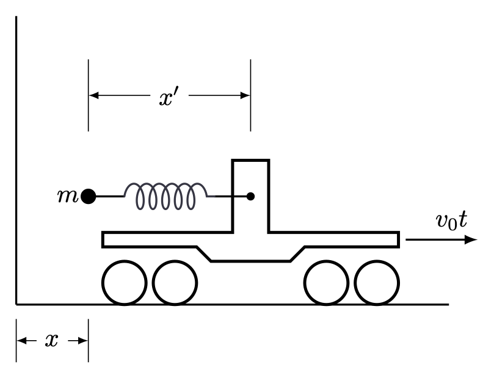



 

우리는 라그랑지안이 운동방정식을 세우고 그로부터 역학계를 기술하는데 아주 유용하다는 것을 안다. 이제 소위 해밀토니안(Hamintonian) 을 통해 운동을 기술하는 방법을 소개하고자 한다. 실제의 운동방정식을 세우고 푸는데 해밀토니안 방법이 라그랑지안 방법보다 유리한 경우는 거의 없다. 그러나 해밀토니안 방법은 고전역학 이후에 발전한 통계역학과 양자역학의 이론적 발전에 지대한 영향을 끼쳤으며, 고전역학을 새로운 관점을 보는데도 매우 유용하다.

여기서는 모든 시스템이 holonomic 이며, 힘이 monogenic 이거나 (즉 위치만의 함수인 포텐셜에 의해 힘이 주어진다) 속도에 의존적인 일반화된 포텐셜의 미분으로 주어지는 경우만을 생각하기로 하자.

 

## 르장드르 변환과 해밀턴 운동방정식

### 라그랑지안 역학과 해밀토니안 역학 {#sec-CM_lagrangian_and_hamiltonian_mechanics_intro}

$n$-자유도 시스템의 라그랑지안 역학은 $n$ 개의 2차 미분방정식(라그랑쥬 방정식) 으로 기술된다.

$$
\dfrac{d}{dt}\left(\dfrac{\partial L}{\partial \dot{q}_j}\right) - \dfrac{\partial L}{\partial q_j} = 0.
$$

이 방정식의 해를 구하기 위해서는 $2n$ 개의 초기값이 필요하며 ($1$) 특정 시간 $t$ 에 대해 $n$ 개의 $q_i(t)$ 와 역시 $n$ 개의 $\dot{q}(t_i)$ 이거나 ($2$) 두 시간 $t_1,\,t_2$ 에 대해 $n$ 개의 $q_i(t_1)$ 과 $q_i(t_2)$ 이다. 즉 $n$ 개의 독립 변수 $\{q_i\}$ 와 시간에 대한 미분 $\{\dot{q}_i\}$ 에 관한 문제이다. 라그랑지안은  각각의 일반화된 좌표로 이루어진 $n$ 차원 짜임새 공간에서 표현된다.

이에 반해 $n$-자유도 시스템의 해밀토니안 역학은 $2n$ 개의 독립변수에 대한 $2n$ 개의 1차 이분방정식으로 기술된다. 필요한 초기조건은 라그랑지안과 동일한 $2n$ 개이며, $2n$ 차원의 위상 공간에서 표현된다. 이 $2n$ 개의 독립변수는 $n$ 개의 일반화된 변수 $\{q_i\}$ 와 $n$ 개의 정준 운동량 $\{p_i\}$ 이며 $(\bf{q},\, \bf{p})$ 를 **정준 변수 (canonical variables)** 라고 한다. 

$$
\boxed{\bf{p} := \dfrac{\partial L(\bf{q},\, \dot{\bf{q}},\,t)}{\partial \dot{\bf{q}}},\qquad \text{or}\qquad  p_i = \dfrac{\partial L(\bf{q},\, \dot{\bf{q}},\,t)}{\partial \dot{q}_i}. }
$$ {#eq-CM_canonical_momentum}

 

::: {.callout-caution icon="false"}

#### 표기법에 대해

특별한 언급이 없는 한 이 장에서 $p_i$ 는 일반화된 좌표 $q_i$ 에 대한 정준운동량을 의미하며 질량에 속도를 곱한 선형 운동량과는 다르다. 일반화된 좌표를 $Q$ 나 $Q_i$ 와 같이 쓸 때의 정준운동량은 $P$ 나 $P_i$ 로 표기하기로 한다. 

또한 다변수 함수의 편미분에 대해 @def-MS_derivative_to_vector 의 표기법을 사용한다.

:::

 

### 르장드르 변환 {#sec-CM_legendre_transformation}

- 참고자료 : @Zia2009

$\bf{x},\, \bf{y}\in \R^n$ 이며 $F:\R^{2n} \to \R$ 이라고 하자. $F$ 가 미분가능하다면

$$
dF = \sum_{i=1}^n \dfrac{\partial F}{\partial x_i} dx_i + \sum_{i=1}^n \dfrac{\partial F}{\partial y_j}dy_j = \dfrac{\partial F}{\partial \bf{x}}\bf{\cdot} d\bf{x} + \dfrac{\partial F}{\partial \bf{y}} \bf{\cdot} d\bf{y}
$$

이며, $\bf{u}=\dfrac{\partial F}{\partial \bf{x}}$ 에 대해

$$
G =  \bf{ u\cdot x} - F
$$

라고 하면

$$
dG = \bf{x \cdot} d\bf{u}  + \bf{u \cdot} d\bf{x}  - dF =  \bf{x \cdot}d\bf{u} - \dfrac{\partial F}{\partial \bf{y}} \bf{\cdot} d\bf{y}
$$

이다. 그렇다면 $G=G(\bf{u},\, \bf{y})$ 이며, $\dfrac{\partial G}{\partial \bf{u}} = \bf{x},\, \dfrac{\partial G}{\partial \bf{y}} = - \dfrac{\partial F}{\partial \bf{y}}$ 이다. 

 

### 해밀토니안 {#sec-CM_hamiltonian}

::: {.callout-note  icon="false"}

#### **해밀토니안**

라그랑지안 $L(\bf{q},\, \dot{\bf{q}},\,t)$ 에 대해 아래와 같은 르장드르 변환을 수행하여 얻은 $H(\bf{q},\, \bf{p},\,t)$ 를 **해밀토니안(Hamiltonian)** 이라고 한다. 

$$
H\left(\bf{q}, \bf{p}, t\right) = \sum_{i} \dot{q}_i p_i - L(\bf{q}, \dot{\bf{q}}, t)
$$ {#eq-CM_hamiltonian}

:::

해밀토니안은 $\bf{q},\, \bf{p},\, t$ 에 대한 함수이므로 그 미분형식은 다음과 같다.

$$
dH = \sum_i \left(\dfrac{\partial H}{\partial q_i}\right) dq_i + \sum_i \left(\dfrac{\partial H}{\partial p_i}\right) dp_i + \dfrac{\partial H}{\partial t}\, dt
$$ {#eq-CM_differential_form_of_hamiltonian}

또한 @eq-CM_hamiltonian 으로 부터, 

$$
dH = \sum_i\left(-\dfrac{\partial L}{\partial q_i}\right)dq_i + \sum_i \left(\dot{q}_i\right)\, dp_i + \left(p_i - \sum_i \dfrac{\partial L}{\partial \dot{q}_i}\right) d\dot{q}_i - \dfrac{\partial L}{\partial t}\,dt
$$

을 얻는다. 여기서 $d\dot{q}_i$ 앞의 항은 $p_i$ 의 정의에 의해 $0$ 이다. 또한 오일러 라그랑쥬 방정식에 의해

$$
0 = \dfrac{d}{dt}\left( \dfrac{\partial L}{\partial \dot{q}_i}\right) - \dfrac{\partial L}{\partial q_i} = \dot{p}_i - \dfrac{\partial L}{\partial q_i} 
$$

이므로, 

$$
dH = -\sum_i \dot{p}_i dq_i + \sum_i \dot{q}_i dp_i - \dfrac{\partial L}{\partial t} dt
$$

이며 이로부터

$$
\boxed{\dot{q}_i = \dfrac{\partial H}{\partial p_i},\qquad \dot{p}_i =- \dfrac{\partial H}{\partial q_i}, }
$$ {#eq-CM_canonical_equation_of_hamiltonian}

$$
\dfrac{\partial H}{\partial t} = -\dfrac{\partial L}{\partial t}
$$ {#eq-CM_time_dependence_of_hamiltonian} 

를 얻는다. @eq-CM_canonical_equation_of_hamiltonian 을 **해밀턴 정준 방정식(canonical equations of Haminton)** 이라고 부른다. 우리는 이를 통해 $n$ 개의 2차 미분방정식(라그랑쥬 방정식) 을 $2n$ 개의 1차 미분방정식(해밀턴의 정준 방정식) 으로 바꿨다. 차이는 (이것은 매우 중요하다) 라그랑지안이 일반화된 좌표계에서 $\bf{q},\, \dot{\bf{q}},\,t$ 의 함수라면 해밀토니안은 $\bf{q},\, \bf{p},\,t$ 의 함수라는 것이다. 해밀턴 정준방정식을 따르는 좌표 $\bf{q},\, \bf{p}$ 를 **정준 좌표 (canonical coordinate)** 라고 한다.(운동량 변수도 정준 좌표에 포함된다.)

### 해밀토니안을 직접 구할 수 있는 경우

해밀토니안은 라그랑지안에 대한 르장드르 변환으로 정의된다. 따라서 다음과 같은 순서로 해밀토니안을 구한다.

&emsp;($1$) 적절한 일반화된 좌표계에서 라그랑지안 $L(\bf{q},\, \dot{\bf{q}},\,t)$ 를 구한다.

&emsp;($2$) 각각의 일반화된 좌표 $q_i$ 에 대한 정준 운동량 $p_i = \dfrac{\partial L}{\partial \dot{q}_i}$ 를 구한다.

&emsp;($3$) @eq-CM_hamiltonian 로 해밀토니안을 구한다.

이것은 진짜로 일반화된 좌표계에서는 쉽지 않은 일이다. $\bf{p}$ 를 구한 후 모든 $\dot{q}_j$ 를 $\bf{q},\, \bf{p},\,t$ 에 대한 함수로 다시 기술해야 하기 때문이다. 하지만 물리적으로 중요한 많은 문제에 대해서는 지름길이 존재한다.

우선 라그랑지안 $L$ 이 $\{\dot{q}_i\}$ 에 대해 $0$, $1$, $2$ 계 동차 함수의 합으로 표현 할 수 있을 때이다. 

::: {.callout-note icon="false"}

#### **동차 함수**

함수 $f(x_1,\ldots,\,x_n)$ 이 자연수 $k$ 에 대해 

$$
f(tx_1,\ldots,\,t x_n) = t^k f(x_1,\ldots,\,x_n)
$$ {#eq-CM_homogeneous_function}

를 만족할 때 이 함수 를 **$k$-계 동차함수 ($k$-order homogeneous function)** 라고 한다.

:::

$k$-계 동차함수 $f$ 가 다음을 만족한다는 것은 잘 알려져 있다.
$$
\sum_{i=1}^n x_i \dfrac{\partial f}{\partial x_i} = k f(x_1,\ldots,\,x_n).
$$ {#eq-CM_differential_of_homogeneous_function}

$L_0,\,L_1,\,L_2$ 를 각각 $\{\dot{q}_i\}$ 에 대한 $0,\,1,\,2$ 계 동차함수이며 $L=L_0 + L_1 + L_2$ 라면, 

$$
H = \sum \dot{q}_i p_i - L_0 - L_1 - L_2 = \sum \dot{q}_i \dfrac{\partial L}{\partial \dot{q}_i} - L_0 - L_1 - L_2 = L_2-L_0
$$

이다. 이것을 $\bf{q}$ 에 대해 표현하면 $L_2$ 는 $\dot{\bf{q}}$ 에 대한 이차함수이며, $L_1$ 은 $\dot{\bf{q}}$ 에 대해 일차함수이다. 따라서, 적당한 상수벡터 $\bf{a}$ 와 행렬 $\bf{T}$ 에 대해 

$$
L_0 = L_0 (\bf{q}),\quad L_1 = \bf{a}^T \dot{\bf{q}},\quad L_2 =\dfrac{1}{2}\dot{\bf{q}}^T \bf{T}\dot{\bf{q}}, 
$$ {#eq-CM_lagramgian_in_matrix_form}

이다. 이 때 정준운동량 $\bf{p}$ 는

$$
\bf{p}= \bf{T}\dot{\bf{q}} + \bf{a}
$$

이다. 일반적으로 $\bf{T}$ 는 [positive definite 행렬](https://julia-kaeri.github.io/Algebra.doc/src/part1/ch1_07_spectrum_theorem.html#positive-positive-definite-행렬과-제곱근-행렬) 이므로 가역행렬이며, 따라서 [positive definite 행렬에 대해서는 선형대수학을 참고하라]{.aside}

$$
\dot{\bf{q}} = \bf{T}^{-1}(\bf{p}-\bf{a})
$$

이다. 따라서 해밀토니안 $H$ 는 아래의 형태이다.

$$
H = \dfrac{1}{2} (\bf{p}-\bf{a})^T \bf{T}^{-1} (\bf{p}-\bf{a}) - L_0(\bf{q}).
$$ {#eq-CM_hamiltonian_form}

::: {#exm-CM_hamiltonian_for_monogenic_potential_in_spherical_coordinate}

#### 구면좌표계의 해밀토니안

구면좌표계 $(r,\,\theta,\,\varphi)$ 에서 구면 대칭 포텐셜 $V(r)$ 의 영향을 받는 입자의 운동에너지는

$$
T=\dfrac{mv^2}{2} = \dfrac{m}{2}\left(\dot{r}^2 + r^2 \sin^2 \theta \,\dot{\varphi}^2 + r^2 (\dot\theta)^2\right)
$$

이다. 여기서

$$
\bf{T} = m\begin{bmatrix}  1 & 0 & 0 \\ 0 & r^2 & 0\\ 0 & 0 & r^2\sin^2\theta \end{bmatrix},\qquad \bf{T}^{-1} = \dfrac{1}{m}\begin{bmatrix}  1 & 0 & 0 \\ 0 & \dfrac{1}{r^2} & 0\\ 0 & 0 & \dfrac{1}{r^2\sin^2\theta} \end{bmatrix}
$$

이며, 따라서 해밀토니안은 $T+V$ 형태이다. 이로부터 시스템의 해밀토니안은
$$
H(r,\,\theta,\,\varphi,\, p_r,\,p_\theta,\,p_\varphi) = \dfrac{1}{2m}\left(p_r^2 + \dfrac{p_\theta^2}{r^2} + \dfrac{p_\varphi^2}{r^2\sin^2\theta}\right)
$$

이다. 그러나 일반화된 좌표계가 데카르트 좌표계라면,

$$
T=\dfrac{mv^2}{2} = \dfrac{\bf{\dot{x}\cdot \dot{x}}}{2}
$$

이며 따라서 해밀토니안은

$$
H(\bf{x},\,\bf{p}) = \dfrac{\bf{p\cdot p}}{2m} + V(\sqrt{\bf{x\cdot x}})
$$

:::

 

::: {#exm-CM_hamiltonian_for_charged_particle_in_electromagnetic_field}

#### 전자기장에서의 하전입자의 해밀토니안

이제 이것을 전자기장에서의 라그랑지안에 대해 생각해보자. @eq-CM_generalized_force 으로 주어진 일반화된 포텐셜에 대해 

$$
L = T-U = \dfrac{1}{2}mv^2 -q\Phi + q \bf{A\cdot v}
$$

이다. 따라서 정준운동량 $\bf{p}$ 는

$$
\bf{p} = \dfrac{\partial L}{\partial \bf{v}} = m\bf{v} + q\bf{A}
$$

이므로, 

$$
H = \dfrac{\|\bf{p}- q\bf{A}\|^2}{2m} + q\Phi
$$ {#eq-CM_hamiltonian_of_charged_particle}

이다. 

:::

### 심플렉틱 표기법 {#sec-CM_symplectic_notation}

$n$-자유도 시스템에 대해 $2n$ 개의 성분을 갖는 벡터 $\bf{\eta}$ 를 $\eta_i = q_i,\, \eta_{n+i} = p_i$ 로 정의하자. 즉
$$
\bf{\eta} = \begin{bmatrix} \bf{q} \\ \bf{p}\end{bmatrix}.
$$ {#eq-CM_vctor_in_simplectic_notation}

이다. 또한 $n\times n$ 영행렬 $\bf{0}_n$ 와 항등행렬 $\bf{1}_n$ 에 대해 $2n \times 2n$ 행렬 $\bf{J}$ 를 다음과 같이 정의하자.

$$
\bf{J} = \begin{bmatrix} \bf{0}_n & \bf{1}_n\\ -\bf{1}_n & \bf{0}_n \end{bmatrix}
$$

그렇다면 해밀턴의 정준방정식 @eq-CM_canonical_equation_of_hamiltonian 은 다음과 같이 쓸 수 있다.

$$
\dot{\bf{\eta}} =  \bf{J}\dfrac{\partial H}{\partial \bf{\eta}}.
$$ {#eq-CM_simplectic_notation_of_hamilton_equation_of_motion}

해밀턴 운동방정식을 위와 같이 표기하는 것을 **심플렉틱 표기법(symplectic notation)** 이라고 한다. 

$\bf{J}$ 를 많이 사용하므로 여기서 $\bf{J}$ 의 기본 성질에 대해 정리하자. 

$$
\bf{J}^2 = \bf{1}_{2n}.
$$ {#eq-CM_symplectic_J_square}

$$
\bf{J}^T\bf{J} = \bf{JJ}^T = \bf{1}_{2n}.
$${#eq-CM_symplectic_J_orthogonality}

$$
\det(\bf{J}) = 1.
$$ {#eq-CM_symplectic_determinant_of_J}

 

### 순환좌표와 보존 정리 {#sec-cyclic_coordinate_hamiltonian}

#### **운동량 보존**

[정준운동량과 위상공간](#sec-CM_variational_phase_space) 에서 다루었던 순환 좌표를 다시 생각해보자. 라그랑지안과 해밀토니안의 관계 즉 $H = \sum_i \dot{q}_i p_i -L$ 을 생각해보면

$$
\dfrac{\partial L}{\partial q_i}=0 \iff \dfrac{\partial H}{\partial q_i}=0
$$

이 성립한다. $\dot{p}_i = - \dfrac{\partial H}{\partial q_i}$ 이므로 $H$ 에 명시적인 $q_i$ 의존성이 없다면 $p_i$ 는 운동상수이다. 순환좌표에 대한 정준운동량이 보존된다는 사실이 해밀토니안 방법에서도 그대로 적용된다.

#### **라그랑지안이 시간에 명시적으로 의존하지 않을 때의 해밀토니안**

또한 해밀턴 운동방정식 @eq-CM_canonical_equation_of_hamiltonian 과 @eq-CM_time_dependence_of_hamiltonian 으로부터
$$
\begin{aligned}
\dfrac{dH}{dt} &= \sum_i \left[\dfrac{\partial H}{\partial q_i} \dot{q_i} + \dfrac{\partial H}{\partial p_i} \dot{p}_i\right] + \dfrac{\partial H}{\partial t} \\[0.3em]
&= \sum_i \left[-\dot{p}_i \dot{q}_i  + \dot{q}_i \dot{p}_i\right] + \dfrac{\partial H}{\partial t} = \dfrac{\partial H}{\partial t} = -\dfrac{\partial L}{\partial t}
\end{aligned}
$$

을 얻는다. 즉 라그랑지안이 명시적으로 시간에 의존적이지 않으면 해밀토니안 값은 운동상수이다. 

#### **일반화된 좌표로의 변환이 시간에 대해 명시적으로 의존하지 않을 때**

앞서 [대칭과 보존](02_variational_principle.qmd#sec-CM_chapter_symmetry_and_conservation)
에서 봤지만 일반화된 좌표 $q_1,\ldots,q_n$ 으로의 변환을 생각하자. 이 때 

$$
\bf{r}_m = \bf{r}_m(q_1,\ldots,\,q_n,\,t)
$$

가 시간에 명시적으로 의존하지 않는며, 포텐셜이 속도에 의존하지 않는다면 $H$(당시는 에너지 함수 $h$)가 운동상수이며 $T+V$ 임을 보았다. 어떤 경우에는 이 좌표 변환이 시간에 명시적으로 의존하더라도 $H$ 는 그렇지 않을 수 있다. 이 경우 $H$ 는 운동상수이지만 총 에너지는 아니다. 앞서 [대칭과 보존](02_variational_principle.qmd#sec-CM_chapter_symmetry_and_conservation) 에서 보았듯이 해밀토니안은 크기와 함수 형태에서 일반화된 좌표계의 선택에 의존한다. 라그랑지안을 $L=T-V$ 로 쓰고 여기서 일반된 좌표계로 변환한다면 함수의 형태는 바뀔지라도 값은 바뀌지 않지만 해밀토니안의 경우는 그 값도 바뀔 수 있다. 어떤 선택에서는 $H$ 가 보존되지만 어떤 선택에서는 시간에 대해 변한다.

::: {#exm-CM_lagrangian_and_hamiltonian_functinal_form}

#### 라그랑지안과 해밀토니안

{#fig-CM_uniformly_moving_cart width=250}

위의 그림과 같이 점질량 $m$ 이 용수철 상수 $k$ 인 용수철에 붙어 있으며 용수철의 반대쪽 끝은 질량이 없는 카트에 붙어 있으며 이 카트는 $v_0$ 의 속력으로 움직이고 있다. 우리가 $x$ 를 일반화된 좌표계로 사용한다면 이 시스템의 라그랑지안 $L$ 은

$$
L(x,\,\dot{x},t) = T-V = \dfrac{m\dot{x}^2}{2} - \dfrac{k}{2}(x-v_0t)^2
$$ {#eq-exm-CM_lagrangian_and_hamiltonian_functinal_form_1}

이다. 문제를 간단하게 하기 위해 차가 $t=0$ 에서 지나는 점을 $x=0$ 으로 잡았다. 운동방정식은

$$
m\ddot{x} = -k(x-v_0t)
$${#eq-exm-CM_lagrangian_and_hamiltonian_functinal_form_2}

이다. 이제 카트의 중심을 기준으로 하는 좌푝 $x'=x-v_0t$ 를 생각하자. 이 경우 운동방정식은

$$
m\ddot{x}' = -kx'
$${#eq-exm-CM_lagrangian_and_hamiltonian_functinal_form_3}

이며, 이 운동방정식으로부터 카트에 타고 있는 관찰자에게는 단순조화진동자 운동이 보인다.

이제 해밀토니안 관점에서 보자. $x$ 는 데카르트 좌표계에서의 좌표이고 포텐셜은 일반화된 운동을 포함하지 않기 때문에 $x$ 에 대한 해밀토니안은 운동에너지와 포텐셜 에너지의 합이다. 즉,

$$
H(x,\,p,\,t) = T+V = \dfrac{p^2}{2m} + \dfrac{k}{2}(x-v_0t)^2.
$${#eq-exm-CM_lagrangian_and_hamiltonian_functinal_form_4}

여기서 해밀토니안은 시스템의 총 에너지이지만 $t$ 에 대한 명시적 의존성을 가진다. 즉 에너지는 보존되지 않는다. 그 이유는 진동하는 입자에 대한 반작용에 반하여 카트를 균일한 속력으로 움직이게 하기 위해선 외부에 에너지가 들어오고 나가야 하기 때문이다.

이제 $x'$ 좌표계에서의 라그랑지안을 구해보면 $L'(x,\,\dot{x})$ 에 $x'=x+v_0t,\, \dot{x}'=\dot{x}+v$ 를 대입하여

$$
L(x',\, \dot{x}') = \dfrac{m\dot{x}'^2}{2} + m\dot{x}'v_0 + \dfrac{mv_0^2}{2} - \dfrac{kx'^2}{2}.
$${#eq-exm-CM_lagrangian_and_hamiltonian_functinal_form_5}

이제 새로운 해밀토니안 $H=H(x',\, p')$ 은

$$
\begin{aligned}
H'(x',\,p') = \dot{x}'p' - L = \dfrac{(p'-mv_0)^2}{2m} + \dfrac{kx'^2}{2}- \dfrac{mv_0^2}{2}.
\end{aligned}
$${#eq-exm-CM_lagrangian_and_hamiltonian_functinal_form_6}

이 식에서 마지막 $mv_0^2/2$ 는 상수항이므로 운동방정식에 영향을 미치지 않으므로 제거해도 무방하다. 마지막 항을 제거한 해밀토니안은 카트 기준 좌표계에서의 총 에너지이다. 이렇게 구한 $H'$ 은 계의 총 에너지가 아니지만 $-\partial L/\partial t = dH'/dt = 0$ 이므로 보존된다. 

:::

 

## 라우스 과정 {#sec-CM_routh_procedure}

해밀토니안 운동방정식으로 역학 문제를 푸는 것은 많은 경우 라그랑지안 방법에 비해 큰 장점이 없다. $2n$ 개의 1차 미분방정식을 풀다보면 결국은 라그랑지안 운동방정식으로 돌아가는 경우도 많다. 여기서는 그 예외를 살펴보겠다. 해밀토니안 운동방정식은 순환 좌표에 관련된 문제를 풀 때 큰 도움이 된다. $\bf{q}\in \R^n$ 에서 $q_n$ 이 순환좌표인 경우를 살펴보자. 이 경우 라그랑지안은 다음과 같다.

$$
L = L(q_1,\ldots,\,q_{n-1}; \dot{q}_1, \ldots,\, \dot{q}_n;t)
$$

일반화된 속도 $\dot{q}_n$ 이 라그랑지안에 나타난다. 비록 순환좌표가 있더라도 일반적인 $n$-자유도 시스템을 풀 때와 크게 다르지 않다. 그러나 해밀토니안의 경우 경우 $p_n$ 이 상수이므로 $p_n=\alpha$ 라고 놓으면

$$
H = H(q_1,\ldots,\,q_{n-1};p_1,\ldots,\,p_{n-1};\alpha;t)
$$

이 된다. 즉 $n-1$-자유도 문제가 되며 $q_n$ 의 변화는

$$
\dot{q}_n = \dfrac{\partial H}{\partial \alpha}
$$

를 통해 얻을 수 있다. 

순환좌표가 있을 경우 해밀토니안과 라그랑지안을 섞어 쓸 수 있는 데 이것은 라우스(Routh) 에 의해 고안되었다.$^{\dagger}$[$^\dagger$ Edward John Routh 는 캐나다 퀘벡 출신이므로 프랑스식으로 라우스 라고 읽는다.]{.aside} $n$-자유도 시스템에서 $q_{s+1},\ldots,\,q_n$ 이 순환좌표일 때 라우시안 $R$ 을 아래와 같이 정의한다.

$$
R(q_1,\ldots,\,q_n;\dot{q}_1,\ldots,\,\dot{q}_{s};p_{s+1},\ldots,\,p_n;t) := \sum_{i=s+1}^n p_i\dot{q}_i-L.
$$ {#eq-CM_definition_of_routhian}

즉 라우시안은 순환좌표가 아닌 좌표에 대해서는 $(q,\,\dot{q})$ 변수를, 순환좌표에 대해서는 $(q,\,p)$ 변수를 사용한다. $R$ 에 대한 미분은 다음과 같다.

$$
dR = \sum_{i=s+1}^n \dot{q}_i dp_i - \sum_{i=1}^s \dfrac{\partial L}{\partial \dot{q}_i}d\dot{q}_i - \sum_{i=1}^n \dfrac{\partial L}{\partial q_i}dq_i - \dfrac{\partial L}{\partial t}dt.
$$

이로부터,

$$
\begin{aligned}
\dfrac{\partial R}{\partial q_i} &= - \dfrac{\partial L}{\partial q_i},\qquad &\dfrac{\partial R}{\partial \dot{q}_i} &= - \dfrac{\partial L}{\partial \dot{q}_i}, \qquad \qquad& i=1,\ldots,\,s,\\[0.3em]
\dfrac{\partial R}{\partial q_i}&=-\dot{p}_i, &\dfrac{\partial R}{\partial p_i} &= \dot{q}_i, & i=s+1,\ldots,\,n
\end{aligned}.
$$ {#eq-CM_equation_of_motion_of_routhian}

비순환 좌표에 대해서는 라우시안에 대한 라그랑쥬 방정식을 다음과 같이 쓸 수 있다는 것을 알 수 있다.

$$
\dfrac{d}{dt}\left(\dfrac{\partial R}{\partial \dot{q}}\right) - \dfrac{\partial R}{\partial q} = 0,\qquad i=1,\ldots,\,s.
$$ {#eq-CM_lagrange_equation_for_non_cyclic_variables_in_routian}

또한 순환변수에 대한 정준 모먼트 $p_j\, (j=s+1,\ldots,\,n)$ 은 상수이므로 $p_{s+i}$ 를 $\alpha_i$ 로 바꾸면 라우시안은

$$
R = R(q_1,\ldots,\,q_n;\dot{q}_1,\ldots,\,\dot{q}_s;\alpha_{1},\ldots,\,\alpha_r;t),\qquad \text{where }r=n-s.
$${#eq-CM_routhian_form_1}

이제 비순환 좌표에 대한 라그랑쥬 방정식 @eq-CM_lagrange_equation_for_non_cyclic_variables_in_routian 은 순환좌표와 무관하게 풀릴 수 있으며 마치 자유도 $s$ 인 시스템의 라그랑쥬 방정식과 같다.  

 

## 변분법으로부터 해밀턴 운동 방정식으로 

### 변형된 해밀턴의 원리 {#sec-CM_modified_hamilton_principle}

- [StackExchange 의 관련 논의](https://physics.stackexchange.com/questions/560216/modified-hamiltons-principle-overconstraining-a-system-by-imposing-too-many-bou)

[해밀턴의 원리](02_variational_principle.qmd#sec-CM_least_action_theorem) 를 상기하자. 라그랑쥬 방정식은 해밀턴의 원리로부터의 자연스러운 결론이다. 이제 해밀턴의 원리로부터 해밀턴의 운동방정식이 자연스럽게 유도됨을 보이고자 한다. 라그랑지안 $L$ 에 대한 action $S_L$ 은 다음과 같다.

$$
S_L = \int_{t_1}^{t_2} L(\bf{q},\, \bf{\dot{q}},\,t)\, dt .
$$

$L(\bf{q},\,\dot{\bf{q}},\,t) = \sum_i \dot{q}_i p_i - H(\bf{q},\, \bf{p},\,t)$ 이므로 라그랑지안이 아닌 해밀토니안을 사용하는 action $S_H$ 를 아래와 같이 정할 수 있다.

$$
S_H = \int_{t_1}^{t_2} \left[\sum_{i} \dot{q}_i p_i - H(\bf{q},\, \bf{p},\,t)\right] \, dt
$$ {#eq-CM_action_in_phase_space}

이다. 여기서 라그랑지안에 대한 $S_L$ 는 짜임새 공간에서의 경로에 대한 적분이지만 해밀토니안에 대한 $S_H$ 는 위상공간에서의 경로에 대한 적분이 이 되며, 해밀토니안 형식에 따라 $\bf{q}$ 와 $\bf{p}$ 는 각각 독립변수로 간주된다. 따라서 @eq-CM_action_in_phase_space 에서 적분되는 함수는 $\bf{q},\, \dot{\bf{q}},\, \bf{p},\, \dot{\bf{p}}$ 의 함수로 표현되어야 한다. 따라서 어떤 경로의 변형 역시 위상공간에서의 경로의 변형 이다. 해밀턴의 원리는 짜임새 공간에서의 action $S_L$ 에 대해 다루는데 **변형된 해밀턴의 원리 (modified Hamilton's principle)** 는 위상공간에서의 action $S_H$ 에 대해 $\delta S_H=0$ 이 되는 위상공간 상의 경로를 따른는 것을 주장한다. 즉

$$
\delta S_H = \delta \int_{t_1}^{t_2} \left[\sum_{i} \dot{q}_i p_i - H(\bf{p},\, \bf{q},\,t)\right] \, dt = 0
$$ {#eq-CM_modified_hamilton_principle}

이다. 이 변형된 해밀턴의 원리가 가장 많이 사용되는 곳은 다음 장에 다룰 변환 이론이지만 여기서 중요한 것은 이 변형된 해밀턴의 원리를 통해 해밀턴의 정준 운동방정식을 유도할 수 있다는 것이다. @eq-CM_modified_hamilton_principle $[\;\cdots\;]$ 안의 함수를 $F$ 라고 임시로 붙이면 $F$ 는 $\bf{q},\, \dot{\bf{q}},\, \bf{p}$ 의 함수이며 $\dot{\bf{p}}$ 에 명시적인 의존성은 없다. 변형된 해밀턴의 원리는

$$
\delta S = \delta\int_{t_1}^{t_2} \left[\sum_i \dot{q}_i p_i - H(\bf{q},\, \bf{p},\,t)\right] \, dt = \delta \int_{t_1}^{t_2}F(\bf{q},\, \dot{\bf{q}},\,\bf{p}, t)\, dt =0
$$

이 된다. 그리고 이에 대한 오일러-라그랑쥬 방정식은, 

$$
\begin{aligned}
\dfrac{d}{dt}\left(\dfrac{\partial F}{\partial \dot{q}_i}\right) - \dfrac{\partial F}{\partial q_i} &= 0, \qquad  i = 1,\ldots,\,n \\
\dfrac{d}{dt}\left(\dfrac{\partial F}{\partial \dot{p}_i}\right) - \dfrac{\partial F}{\partial p_i} &= 0, \qquad  i = 1,\ldots,\,n \\
\end{aligned}
$$ {#eq-CM_euler_lagrange_equation_from_action_using_hamiltonian}

이다. 첫번째 식으로부터 

$$
\dot{p}_i = - \dfrac{\partial H}{\partial q_i}
$$ {#eq-CM_canonical_equation_from_modified_hamiltonian_principle_1}

를 얻을 수 있으며, $F$ 는 명시적인 $\dot{p}_i$ 의존성이 없으므로 두번째 식으로부터

$$
\dot{q}_i = \dfrac{\partial H}{\partial p_i}
$$ {#eq-CM_canonical_equation_from_modified_hamiltonian_principle_2}

를 얻는다. 즉 우리는 변형된 해밀턴의 원리로부터 해밀턴의 운동방정식을 얻었다. 여기서 몇가지를 정리해 보기로 하자.

($1$) 변형된 해밀톤의 원리는 해밀턴의 원리와 동일한지 아니면 다른 추가적인 물리적인 의미를 가지고 있는지에 대해 의문을 가질 수 있다. Goldstein 에 의하면 이 질문은 irrelevant 하다(@Goldstein1980Mechanics pp. 363, 3판의 경우는 pp. 354-355). 해밀턴의 원리가 정당한 것은 해밀턴의 원리의 결과가 라그랑쥬 방정식이기 때문이다. 변형된 해밀턴의 원리가 정당한 것은 그 결과가 해밀턴 운동방정식이기 때문이다. 

($2$) 해밀턴의 원리와 변분원리에서는 양 끝점에서의 변화가 $0$ 임을 가정하였으나 변형된 해밀토니안의 원리에 이를 적용한다면 운동량에 대해서도 $\delta p_i(t_1)= \delta p_i(t_2)=0$ 임을 가정해야 할 것 같다. 그런데 이 가정은 필요가 없는 것이, @exr-CM_variational_devivation_of_euler_lagrange_eq 에서 보았듯이 $\delta p_i = 0$ 이 필요한 것은 부분적분에서 

$$
\left.\dfrac{\partial F}{\partial \dot{p}_i} \dfrac{\partial p_i}{\partial \alpha} \right|_{t_1}^{t_2}
$$

인 부분이다. 그런데 $F$ 는 $\bf{\dot{p}}$ 에 명시적인 의존성이 없기 때문에 위의 항은 항상 $0$ 이다. 즉 변형된 해밀톤의 원리에로부터 해밀턴 운동방정식을 유도할 때 $\delta \bf{p}=0$ 의 조건은 필요하지 않다. <u>즉 해밀턴의 원리와 변형된 해밀턴의 원리는 동일한 경계조건을 사용한다.</u>

 

## 연습문제 {.unnumbered}

::: {#exr-CM_goldstein_8_1}
#### Goldstein 8.1

($a$) 해밀토니안 $H(q_i,\,p_i,\,t)$ 로부터 $\dot{\bf{q}}$ 를 독립 변수로 취급하여 라그랑지안 $L(q_i,\,\dot{q}_i,t)$ 를 구하라.

($b$) 같은 과정을 통해 다음 함수를 이용하여 운동방정식을 구하라.

$$
L'(p,\, \dot{p},\,t) = -\dot{p} q - H(q,\,p,\,t)
$$

:::

::: {.solution}

($a$) $L(q,\,p) := \sum_i p_i\dot{q}_i - H(q_i,\,p_i)$ 라고 하면,

$$
\dfrac{d}{dt}\left(\dfrac{\partial L}{\partial \dot{q}_i}\right) -\dfrac{\partial L}{\partial q_i } = \dfrac{dp_i}{dt} + \underbrace{\dfrac{\partial H}{\partial q_i}}_{\Large = -\dot{p}_i} =  0.
$$

($b$)

$$
\begin{aligned}
\dfrac{d}{dt}\left(\dfrac{\partial L'}{\partial \dot{p}}\right) - \dfrac{\partial L'}{\partial p} &= -\dfrac{dq}{dt} + \dfrac{\partial H}{\partial p} = 0, \\[0.3em]
\dfrac{d}{dt}\left(\dfrac{\partial L'}{\partial \dot{q}}\right) - \dfrac{\partial L'}{\partial q} &=  \left(\dot{p} +  \dfrac{\partial H}{\partial q} \right) = 0.
\end{aligned}
$$

:::

 

::: {#exr-CM_goldstein_8_2}
#### Goldstein 8.2

라그랑지안 $L(q_i,\,\dot{q}_i,t)$ 에 함수 $g(q_i,\,t)$ 의 시간에 대한 미분을 더해도 운동방정식에 변화가 없다는 것을 안다. 이 경우 정준 운동량과 해밀토니안은 어떻게 바뀌는가? 새로운 해밀토니안에 대한 운동방정식 역시 변하지 않음을 보여라.

:::

::: {.solution}

$\overline{L}(q_i,\,\dot{q}_i,\,t) = L(q_i,\,\dot{q}_i,t) + \dfrac{dg(q_i,t)}{dt}$ 에 대해 

$$
\dfrac{dg}{dt} = \sum_i\dfrac{\partial g}{\partial q_i}\dot{q}_i + \dfrac{\partial g}{\partial t}
$$

임을 이용하면, 새로운 정준운동량은
$$
\overline{p}_i = \dfrac{\partial \overline{L}}{\partial \dot{q}_i} = p_i + \dfrac{\partial g}{\partial q_i}
$$

이며, 새로운 해밀토니안은

$$
\begin{aligned}
\overline{H} &= \sum_i \overline{p}_i\dot{q}_i - \overline{L} = \sum_i \left(p_i+\dfrac{\partial g}{\partial q_i}\right)\dot{q}_i - L - \dfrac{dg}{dt} \\[0.3em]
&= \sum_i p_i\dot{q}_i - L - \dfrac{\partial g}{\partial t} = H\left(q,\,\overline{p}-\dfrac{\partial g}{\partial q_i},\,t \right)-\dfrac{\partial g}{\partial t}
\end{aligned}
$$

이다. 여기서

$$
\begin{aligned}
\dfrac{\partial \overline{H}}{\partial q_i} &= \dfrac{\partial H}{\partial q_i} - \sum_j\underbrace{\dfrac{\partial H}{\partial p_j}}_{=\dot{q}_j} \left(\dfrac{\partial g^2} {\partial q_i\partial q_j}\right) - \dfrac{\partial^2 g}{\partial q_i\partial t} \\[0.3em]
&=\dfrac{\partial H}{\partial q_i} - \dfrac{d}{dt}\left(\dfrac{\partial g}{\partial q_i}\right) = \dfrac{d\overline{p}_i}{dt}, \\[0.3em]
\dfrac{\partial \overline{H}}{\partial \overline{p}_i} &= \dfrac{\partial H}{\partial p_i} = \dot{q}_i
\end{aligned}
$$

이므로 정준 운동방정식이 보존된다.

:::

 

::: {#exr-CM_goldstein_8_6}
#### Goldstein 8.6

해밀톤 원리는 다음 식으로 쓰일 수 있음을 보여라.

$$
\delta \int_1^2 \left[2H(\bf{\eta},\,t) + \bf{\eta J \dot{\eta}} \right]\, dt = 0
$$

:::

::: {.solution}

$$
\bf{\eta J \doe\et
$$

:::
